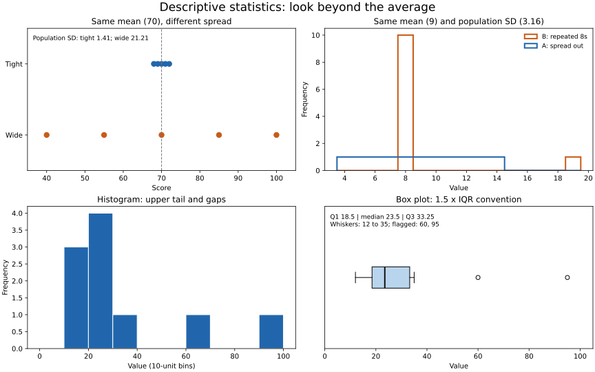

# Lesson 1: Descriptive Statistics and Visual Summaries

[Theory index](../README.md) · [Module overview](./README.md)

**Course:** Data Science and Analytics  
**Module VI:** Exploratory Data Analysis (EDA)  
**Estimated study time:** 50 minutes

## Learning objectives

- Compute and interpret mean, median, and mode.
- Compare range, IQR, and standard deviation.
- Read a five-number summary and recognise signs of asymmetry.
- Explain how box-plot conventions affect interpretation.
- Combine numerical summaries with plots before modelling.

## 1. Centre: what is a typical value?

| Measure | Definition | Useful interpretation |
| --- | --- | --- |
| Mean | Sum divided by count | Arithmetic balance point; sensitive to extreme magnitudes |
| Median | Middle sorted value, or average of the two middle values | Central position; more resistant to extreme magnitudes |
| Mode | Most frequent value or values | Common category or repeated numeric value |

For income, a few very large values can make the mean much higher than most people's income. The median can better describe the middle person's income, while the mean still answers a different useful question about totals per person.

The median is robust, not immune to change. Adding or replacing enough observations can move it. A mean–median gap suggests asymmetry or extremes but is not a complete test for either. Equal mean and median do not prove a symmetric, single-peaked distribution.

A dataset may have multiple modes. With all values distinct, reporting every tied value as a “mode” is usually uninformative; report that there is no unique most frequent value.

Choose a centre according to the question, measurement type, and distribution. A mean is not meaningful for unordered category labels.

## 2. Spread: how much do observations vary?

| Measure | Definition | Main limitation or strength |
| --- | --- | --- |
| Range | Maximum − minimum | Uses only the two extremes |
| IQR | Q3 − Q1 | Describes the central half and resists a few extreme tail values |
| Standard deviation | Square root of a mean squared deviation, with a stated denominator | Uses all values; sensitive to extremes |

Standard deviation is not the average absolute distance from the mean. It is a root-mean-square measure, with a distinction between population and sample formulas.

```text
Population SD = sqrt(sum((x - mean)^2) / n)
Sample SD     = sqrt(sum((x - sample_mean)^2) / (n - 1))
```

Use population SD to describe the full supplied set as a population. Use the conventional sample SD when estimating population variability from a sample. The lesson's worked class examples use population SD.

### Same centre, different spread

| Class | Scores | Mean | Population SD | Range |
| --- | --- | ---: | ---: | ---: |
| Tight | 68, 69, 70, 71, 72 | 70 | 1.414... | 4 |
| Wide | 40, 55, 70, 85, 100 | 70 | 21.213... | 60 |

The wide class has 15 times the population SD of the tight class. The same mean hides substantial differences between students.

A small SD means the mean is closer to most observations as a description. It does not by itself establish the accuracy of the measurements, representativeness of the sample, or uncertainty of an estimated population mean. “Trust the mean” should not blur these separate questions.

## 3. Shape and the five-number summary

The five-number summary is:

```text
minimum, Q1, median, Q3, maximum
```

Q1 is the 25th percentile and Q3 the 75th. Their separation is the IQR. Quantile algorithms differ, particularly for small datasets; record the convention used.

This lesson explicitly uses NumPy's linear percentile method, matching the default method in the supplied exercise. See [NumPy's percentile reference](https://numpy.org/doc/stable/reference/generated/numpy.percentile.html).

Shape may be symmetric, left-skewed, right-skewed, or multimodal. Unequal tail lengths and unequal distances from the median to Q1 and Q3 can suggest asymmetry.

Five numbers compress a distribution. They do not uniquely determine its shape, show every gap, or reliably expose multiple peaks. Confirm suggested patterns using the observations and plots.

### Box-plot whiskers are a convention

A simple min–max box plot places whiskers at the minimum and maximum. A common modified box plot instead uses:

```text
lower fence = Q1 - 1.5 × IQR
upper fence = Q3 + 1.5 × IQR
```

Whiskers reach the most extreme observed values within the fences; observations outside are shown separately. The fences are not generally observed whisker endpoints.

An outlier flag is a reason to investigate, not proof of a recording error or an instruction to delete the observation. Both box-plot variants are described by [NIST](https://www.itl.nist.gov/div898/handbook/eda/section3/boxplot.htm).

## 4. Why statistics need visual summaries

Different datasets can share means and variances while having different patterns. Anscombe's quartet extends this lesson to paired data: its datasets have closely matching numerical summaries, including correlation, but very different scatter plots.

Use the visual appropriate to the question:

| Plot | What to inspect |
| --- | --- |
| Histogram | Shape, tails, peaks, and gaps; inspect sensitivity to binning |
| Box plot | Median, central spread, group differences, and flagged extremes |
| Dot plot | Individual observations, useful for small datasets |
| Scatter plot | Relationships, curvature, clusters, and influential observations |

A plot is not infallible: choices of bins, axes, aggregation, and scale affect what appears. Use several complementary views and numerical checks rather than declaring that only a plot can answer a question.



The figure uses the exact lesson data. Its box plot follows the 1.5×IQR convention, and its histograms display counts rather than densities.

## 5. Worked practice

### Practice 1 — Add an extreme low score

```python
import statistics as st

scores = [68, 70, 71, 69, 72, 70]
for name, data in [("clean", scores), ("with outlier", scores + [5])]:
    print(name, "mean", round(st.mean(data), 1), "median", st.median(data))
```

Expected output:

```text
clean mean 70 median 70.0
with outlier mean 60.7 median 70
```

The mean falls by about 9.3 points, while the median remains 70 in this example. Reporting both explains the unusual low value's effect without pretending it does not exist.

### Practice 2 — Compare two equal means

The tight and wide classes in section 2 both have mean 70. Their population SDs round to 1.4 and 21.2; their ranges are 4 and 60.

As a teacher, the wide class deserves closer investigation because the mean conceals both low and high attainment. That concern is about student variation, not evidence that the mean was calculated incorrectly.

### Practice 3 — Calculate quartiles and inspect a tail

```python
import numpy as np

data = np.array([12, 15, 18, 20, 22, 25, 28, 35, 60, 95])
q1, median, q3 = np.percentile(data, [25, 50, 75], method="linear")
print("five-number:", [float(data.min()), float(q1), float(median),
                       float(q3), float(data.max())])
print("IQR:", q3 - q1)
```

Expected output:

```text
five-number: [12.0, 18.5, 23.5, 33.25, 95.0]
IQR: 14.75
```

The median is 5 above Q1 and 9.75 below Q3. The upper tail is also longer, suggesting right skew. The histogram and box plot show that pattern more directly.

With 1.5×IQR fences, the upper fence is 55.375. The upper whisker ends at the largest observation within it, 35; 60 and 95 are flagged separately. The lower fence is −3.625, so the lower whisker is 12.

The IQR focuses on the middle values rather than being driven by the maximum 95. It still does not describe every part of the tail.

### Practice 4 — Same mean and SD, different observations

```python
import statistics as st

A = [10, 8, 13, 9, 11, 14, 6, 4, 12, 7, 5]
B = [8, 8, 8, 8, 8, 8, 8, 19, 8, 8, 8]

for name, data in [("A", A), ("B", B)]:
    print(name, "mean", st.mean(data),
          "population SD", round(st.pstdev(data), 2))
```

Expected output:

```text
A mean 9 population SD 3.16
B mean 9 population SD 3.16
```

These means and population variances match exactly mathematically: mean 9 and variance 10. Yet A contains the integers 4 through 14, while B contains ten 8s and one 19.

The figure shows their different histograms. Their medians also differ: 9 for A and 8 for B.

This is a one-dimensional demonstration of the Anscombe principle, not a reproduction of the full paired-data quartet. A scatter plot is needed to inspect the quartet's relationship patterns and correlations.

### Practice 5 — A first-look routine

1. Confirm what the column measures, its units, valid domain, and missing-value encodings.
2. Count observations and missing entries; inspect impossible or suspicious values without silently removing them.
3. Calculate mean and median; inspect mode when repeated values or categories make it useful.
4. Calculate range, population or sample SD as appropriate, and IQR.
5. Record the five-number summary and quantile method.
6. Draw a histogram for shape and a box plot for central spread and flagged extremes.
7. Add a dot plot for a small sample and a scatter plot when examining a relationship.
8. Investigate anomalies against the source and document decisions.
9. Report a suitable centre alongside spread, sample size, and visual context.

For unfamiliar student ages, first verify whether ages are years, whether zeros encode missingness, and whether the plausible domain is correct. Compare the mean and median, inspect the histogram for age groups, and review extreme values in the box plot. An unusually old student is not automatically an error.

The standing rule is to inspect both summaries and plots before drawing conclusions.

## 6. Reproduce the calculations and figure

[lesson01-descriptive-demo.py](./lesson01-descriptive-demo.py) computes all the numerical examples with an explicit linear percentile method. It uses Python's statistics module and NumPy.

From this directory:

```powershell
python lesson01-descriptive-demo.py
python lesson01-descriptive-demo.py --plot
```

The plotting option additionally needs Matplotlib and generates lesson01-summary-plots.svg and a PNG preview. The committed SVG is shown above.

[lesson01-requirements.txt](./lesson01-requirements.txt) records the NumPy and Matplotlib versions used for this example. Install them in a project environment to reproduce the run.

The supplied fixtures are finite, non-missing numeric values. The helper is not a general automatic cleaning routine: decide missing-data and validation policies before applying it to arbitrary columns.

## 7. Theory exercises — suggested answers

These are study references. Explain the reasoning in your own words for course submissions.

### Task 1 — Mean versus median

The mean uses every observation's magnitude, so an extreme value can pull it strongly. The median depends on the middle sorted positions and is usually less affected by a small number of extreme values.

For example, four workers earning 30,000 each and one executive earning 1,000,000 have a mean salary of 224,000 but a median of 30,000. Reporting only the mean would give a misleading impression of what a typical employee earns.

### Task 2 — Spread and the representativeness of a mean

Dataset A's mean of 50 is more representative of individual observations because its small standard deviation means they cluster closely around 50. In Dataset B, a large standard deviation means many values may be far from the same mean.

Both arithmetic means are valid. The difference is how well one number describes the observations, not proof that A's measurements or sampling process are more reliable.

### Task 3 — Analyse the five-number summary

The middle 50% lies between Q1=12 and Q3=30. Its IQR is 30 − 12 = 18.

The median 15 is much nearer Q1 than Q3, and the upper extreme 100 is much farther from the box than the lower extreme 10. These features suggest a right-skewed distribution with a long upper tail. A plot should confirm its detailed shape; the five numbers alone cannot establish every feature.

### Task 4 — IQR versus range

The range is maximum minus minimum and describes the full observed extent. Because it uses only the two extremes, one unusually large or small value can change it substantially.

The IQR is Q3 minus Q1 and describes the spread of the central half. It is a better summary of that central spread when a few extreme values or heavy tails make the full range unrepresentative of most observations. Reporting the range can still be useful when the extremes themselves matter.

### Task 5 — Why visualisation is necessary

Anscombe's quartet shows that datasets with closely matching means, variances, and correlations can have very different relationships, including curvature and influential outliers.

Summary statistics compress the data and lose information about arrangement and shape. Scatter plots reveal relationship patterns that the shared summaries hide; histograms and box plots provide complementary checks for individual variables.

An analyst should therefore use numerical and visual summaries together before choosing a model or interpreting a relationship.

## 8. Quick revision

- The mean uses magnitudes; the median uses sorted positions.
- A mode may be nonunique.
- Pair a centre with spread and sample size.
- Specify population versus sample SD.
- Record the percentile convention.
- Five numbers suggest shape but do not fully determine it.
- Box-plot whiskers depend on the chosen convention.
- Flagged outliers require investigation, not automatic deletion.
- Matching statistics do not imply matching distributions.

## Sources

- User-supplied course material: *Module VI: Exploratory Data Analysis (EDA), Descriptive Statistics and Visual Summaries*.
- [NIST: Box Plot](https://www.itl.nist.gov/div898/handbook/eda/section3/boxplot.htm) — min–max and fence-based variants.
- [NumPy: percentile](https://numpy.org/doc/stable/reference/generated/numpy.percentile.html) — explicit quantile-method convention.

Worked responses, clarifying notes, calculations, and plots were prepared for this repository.

[Module overview](./README.md) · [Theory index](../README.md)
