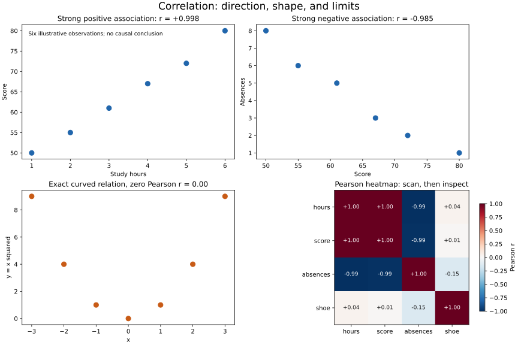

# Lesson 2: Correlation Analysis and Pattern Recognition

[Theory index](../README.md) · [Module overview](./README.md) · [Previous lesson](./Lesson-01-Descriptive-Statistics-and-Visual-Summaries.md)

**Course:** Data Science and Analytics  
**Module VI:** Exploratory Data Analysis (EDA)  
**Estimated study time:** 55 minutes

## Learning objectives

- Interpret Pearson's correlation coefficient without confusing direction and strength.
- Distinguish weak linear association from absence of all relationships.
- Use correlation matrices, heatmaps, and scatter plots together.
- Recognise possible confounding and reverse causation.
- Plan a responsible follow-up to an observed association.

## 1. Pearson's r: a summary of linear association

Pearson's r is a unitless measure of linear association between paired numeric variables. For nonconstant inputs it lies between −1 and +1, apart from numerical precision.

| Value | Interpretation |
| --- | --- |
| +1 | An exact positive straight-line relationship |
| Near +1 | Strong positive linear association |
| Near 0 | Little or no linear association in the observed sample |
| Near −1 | Strong negative linear association |
| −1 | An exact negative straight-line relationship |

The **sign** gives direction. Positive means higher values of one variable tend to accompany higher values of the other; negative means they tend to accompany lower values.

The **magnitude**, |r|, gives the strength of the linear pattern. Correlations +0.85 and −0.85 have the same magnitude but opposite directions.

A coefficient of −0.85 does not mean an 85% decrease, a slope of −0.85, or an 85% causal effect. Correlation is not a measurement of causal impact.

### Preconditions and limits

- Pair values from the same observations; do not independently sort the two columns.
- Establish how missing and invalid pairs are handled.
- A constant input has undefined correlation, not correlation zero.
- Extreme observations, restricted ranges, and mixtures of groups can affect r.
- Report the sample size and inspect the data rather than relying only on a rounded coefficient.

Strength labels depend on context; the coefficient alone does not describe sampling uncertainty or establish statistical significance. Computing r does not itself require a normal distribution, although particular inferential tests can require additional assumptions.

See [SciPy's Pearson reference](https://docs.scipy.org/doc/scipy/reference/generated/scipy.stats.pearsonr.html) for definitions and constant-input limitations.

## 2. Low correlation can hide a curved relationship

For the symmetric input:

```text
x = [-3, -2, -1, 0, 1, 2, 3]
y = [ 9,  4,  1, 0, 1, 4, 9]
```

Every y value is determined exactly by y = x². Yet Pearson's r is zero because the negative and positive sides balance in the linear covariance.

The correct interpretation is “no linear association for these points,” not “no relationship.”

Not every U-shaped sample has r near zero: an asymmetric x range or unequal sampling can change the coefficient. The zero result belongs to this symmetric example.

A scatter plot exposes the curve. Other analyses can investigate nonlinearity too; the plot is a practical first check rather than the only possible way to discover it. Rank correlation is not a universal cure for a U-shape either, because the relationship is not monotonic across both sides.

## 3. Heatmap first, then targeted inspection

A correlation matrix contains the coefficient for each pair of variables. A heatmap displays those coefficients using a colour scale.

A Pearson heatmap screens for **linear** associations; it cannot identify all related pairs. A pale cell can still hide a curve.

| Tool | Main question | Limitation |
| --- | --- | --- |
| Correlation heatmap | Which pairs have notable linear coefficients? | Compresses shape and inherits Pearson's blind spots |
| Scatter plot | What arrangement do paired observations form? | May hide overlapping points and depends on scales and grouping |

For 50 numeric variables there are:

```text
50 × 49 / 2 = 1,225 distinct unordered pairs
```

Start with a heatmap to prioritise investigation, then inspect scatter plots of selected pairs. Include domain-important pairs even when their coefficient is small. Look for curvature, clusters, changing spread, and influential observations.

Many inspected pairs also create opportunities for chance patterns. Treat a large coefficient as a hypothesis to investigate, not automatic proof that a population relationship exists.



The first two panels and heatmap use the six-row teaching dataset. Their labels are illustrative measurements, not evidence from a study.

## 4. Correlation does not establish causation

Variables can be associated because of:

- A causal effect in one direction, or feedback in both directions.
- A third factor influencing both variables.
- Selection, measurement, or other features of how the data was collected.
- Chance variation, especially when many comparisons are made.

A **confounder** can create or distort an observed association. In the classic ice-cream and drowning illustration, hot weather can increase both ice-cream purchases and swimming exposure. The association alone does not justify claiming that ice cream causes drownings.

The course's r≈0.9 and zero-effect graphic is a teaching illustration, not a supplied dataset or a measured causal estimate. Do not infer an exact causal effect of zero from correlation alone either.

### Responsible causal follow-up

Check definitions, pairing, timing, selection, sample size, and plausible third variables. Comparing similar groups can help diagnose alternative explanations, but adjustment only addresses the factors and assumptions actually handled.

A well-designed randomised experiment can support a causal comparison by making treatment assignment independent of baseline characteristics in expectation. It still needs a defined outcome, adequate sample, appropriate follow-up, and attention to noncompliance or missing outcomes. One A/B test is not an unconditional guarantee about every population or implementation.

## 5. Worked practice

### Practice 1 — Compute direction and strength

```python
import numpy as np

hours = np.array([1, 2, 3, 4, 5, 6])
score = np.array([50, 55, 61, 67, 72, 80])
absences = np.array([8, 6, 5, 3, 2, 1])

print(f"hours vs score: {np.corrcoef(hours, score)[0, 1]:+.5f}")
print(f"score vs absences: {np.corrcoef(score, absences)[0, 1]:+.5f}")
```

Expected output:

```text
hours vs score: +0.99780
score vs absences: -0.98512
```

Hours and score have a strong positive linear association in these six observations. Score and absences have a strong negative association.

Rounding the first value to two decimals produces +1.00, but the underlying data do not lie exactly on one line. Preserve enough precision to avoid calling an approximate relationship perfect.

Neither coefficient establishes that changing study time or absences would cause a particular change in score.

### Practice 2 — Calculate the U-shape's coefficient

```python
import numpy as np

x = np.arange(-3, 4)
y = x ** 2
print(f"Pearson r: {np.corrcoef(x, y)[0, 1]:.2f}")
```

Expected output:

```text
Pearson r: 0.00
```

The scatter plot shows a perfectly determined curve. Concluding “no relationship” would confuse a linear summary with a general test of association.

### Practice 3 — Read the matrix and choose follow-ups

The columns are hours, score, absences, and a shoe-size example:

| Variable | hours | score | absences | shoe |
| --- | ---: | ---: | ---: | ---: |
| hours | +1.00 | +1.00 | −0.99 | +0.04 |
| score | +1.00 | +1.00 | −0.99 | +0.01 |
| absences | −0.99 | −0.99 | +1.00 | −0.15 |
| shoe | +0.04 | +0.01 | −0.15 | +1.00 |

Values are rounded for display; off-diagonal +1.00 is not exact.

Use rowvar=False in np.corrcoef when observations are rows and variables are columns. Its default uses rows as variables, which would answer a different question here. See [NumPy's corrcoef reference](https://numpy.org/doc/stable/reference/generated/numpy.corrcoef.html).

Prioritise hours–score and score–absences scatter plots. Shoe-size coefficients are weak in this tiny fixture, including about −0.146 with absences. These numbers do not prove that shoe size is independent of other variables in a larger population, and a low coefficient is not a reason to skip a domain-motivated nonlinear check.

A matrix is symmetric and its nonconstant-variable diagonal is 1; the two triangles repeat the same unordered pairs.

### Practice 4 — Diagnose alternative explanations

| Observed association | Plausible explanation to investigate |
| --- | --- |
| Ice-cream sales and drowning deaths | Hot weather and swimming exposure affect both |
| Firefighter numbers and property damage | More severe fires require more responders and cause more damage |
| Study hours and scores | A causal contribution is plausible; prior preparation, motivation, or support may also affect both |
| Numbers of churches and bars across cities | Larger populations can support more of both |

These are hypotheses about the data-generating process, not proof from the coefficient alone.

Sending fewer firefighters because larger crews accompany larger losses would mistake response to fire severity for evidence that the response causes the losses.

### Practice 5 — Follow up the dark-theme association

1. **Plausible confounders:** prior engagement, user experience, device type, baseline progress, or usage time.
2. **Data checks:** verify completion-rate denominators, ensure theme use precedes the measured outcome, compare baseline characteristics, inspect subgroup plots, and examine missingness and selection.
3. **Experiment:** randomly assign a theme treatment or default, specify the completion outcome and follow-up window in advance, and analyse according to the assignment and actual design.
4. **Manager statement:** “Dark-theme use is associated with completion, but we need stronger causal evidence before treating a forced rollout as a way to improve completion.”

Comparing only observed theme users can mix the theme's effect with users' preferences and habits. If the experiment assigns a default but users can switch, its cleanest causal question concerns assignment of that default, not automatically the effect of actual dark-theme use.

Observational causal designs can also be informative under explicit assumptions. The lesson's A/B test is a clear design option rather than the only conceivable source of causal evidence.

## 6. Reproduce the numbers and figure

[lesson02-correlation-demo.py](./lesson02-correlation-demo.py) calculates the exact fixture correlations, prints the matrix, and generates the four-panel figure when requested.

From this directory:

```powershell
python lesson02-correlation-demo.py
python lesson02-correlation-demo.py --plot
```

The example uses the same NumPy and Matplotlib versions recorded in [lesson01-requirements.txt](./lesson01-requirements.txt). Numerical execution needs NumPy; plotting additionally needs Matplotlib.

The helper rejects unequal, nonfinite, or constant inputs rather than silently deciding how to clean them. It computes coefficients only: it does not provide significance tests, confidence intervals, or causal estimates.

The --plot option writes lesson02-correlation-plots.svg and a PNG preview. This is an illustrative six-row analysis, not a fitted predictive or causal model.

## 7. Theory exercises — suggested answers

These are study references. Explain the ideas in your own words for course submissions.

### Task 1 — Interpret r = −0.85

The negative sign indicates that higher values of one variable tend to accompany lower values of the other. The magnitude 0.85 indicates a strong linear association in the observed data.

It does not imply a causal relationship or tell us the size of a change in the variables' original units. Sample size and the scatter plot still matter.

### Task 2 — Linear versus nonlinear relationships

A coefficient of 0.02 shows very little linear association, but it does not rule out a strong curved relationship. For example, a symmetric U-shaped pattern can have Pearson correlation near zero.

The analyst should draw a scatter plot and inspect it for curves, clusters, outliers, and other patterns before concluding that there is no relationship.

### Task 3 — Heatmaps and scatter plots

First use a correlation heatmap to scan the 50 variables for notable linear associations. Then draw scatter plots for promising pairs and any pairs that matter to the question, including some with low correlations where nonlinear behaviour is plausible.

There are 1,225 distinct pairs, so examining each separately at the outset is time-consuming. The heatmap helps prioritise work, while scatter plots reveal shape and influential points that its coefficients hide.

### Task 4 — Apply the causation rule

More firefighters and greater property damage may occur together because fire severity influences both. A large fire can cause more damage while also requiring more responders.

The observed correlation therefore does not show that sending more firefighters causes the damage. Making that claim ignores a plausible confounder and the timing of the response.

### Task 5 — Coefficient extremes

With nonconstant numeric inputs, r=+1 means all observations lie exactly on a straight line with positive slope: as one variable increases, the other increases linearly.

With r=−1, all observations lie exactly on a straight line with negative slope: as one increases, the other decreases linearly.

Both are perfect linear associations with equal strength and opposite directions. Neither value alone establishes causation.

## 8. Quick revision

- The sign gives direction; the magnitude gives linear strength.
- Correlation is unitless and is not a slope or causal effect.
- A rounded 1.00 need not be an exact 1.
- Zero Pearson correlation can coexist with a deterministic curve.
- A heatmap screens coefficients, not all possible relationships.
- Constant inputs have undefined correlation.
- Pair observations correctly and document missing-data handling.
- Investigate confounding, timing, and selection.
- Use an appropriate study design before making causal claims.

## Sources

- User-supplied course material: *Module VI: Exploratory Data Analysis (EDA), Correlation Analysis and Pattern Recognition*.
- [SciPy: pearsonr](https://docs.scipy.org/doc/scipy/reference/generated/scipy.stats.pearsonr.html) — Pearson interpretation and undefined constant inputs.
- [NumPy: corrcoef](https://numpy.org/doc/stable/reference/generated/numpy.corrcoef.html) — correlation matrices and variable orientation.

Worked responses, clarifying notes, calculations, and plots were prepared for this repository.

[Previous lesson](./Lesson-01-Descriptive-Statistics-and-Visual-Summaries.md) · [Module overview](./README.md) · [Theory index](../README.md)
