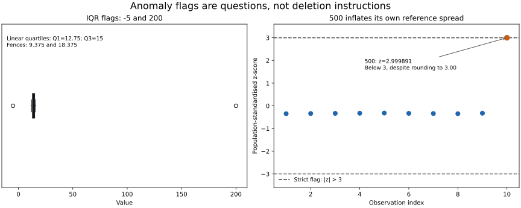

# Lesson 3: Detecting Anomalies and Discovering Insight

[Theory index](../README.md) · [Module overview](./README.md) · [Previous lesson](./Lesson-02-Correlation-Analysis-and-Pattern-Recognition.md)

**Course:** Data Science and Analytics  
**Module VI:** Exploratory Data Analysis (EDA)  
**Estimated study time:** 50 minutes

## Learning objectives

- Flag unusual values using IQR fences and standardised scores.
- Explain the limits of both screening rules.
- Investigate an anomaly before deciding how to handle it.
- Turn summaries and plots into an iterative chain of questions.
- Use automated profiling as a first pass rather than a substitute for judgement.

## 1. Outlier detection is screening

An outlier is an observation that differs markedly from a reference pattern. Its meaning depends on the variable, population, units, time, and context.

Two useful screening rules are:

| Method | Rule used here | Main consideration |
| --- | --- | --- |
| IQR | x < Q1 − 1.5×IQR or x > Q3 + 1.5×IQR | Quartiles resist a few extremes better than the mean and SD |
| Z-score | abs(z) > 3, where z = (x − mean) / SD | The reference mean and SD can be distorted by unusual observations |

Both produce **flags**, not definitive classifications of error, fraud, or scientific novelty. A domain violation such as a negative exam percentage can require attention even when no statistical screen flags it.

### IQR: robust, not immovable

Calculate Q1, Q3, and IQR = Q3 − Q1, then form the fences. This lesson uses NumPy's linear percentile convention, consistent with the earlier lessons.

IQR screening does not require normality. However, quartiles can change with sample size, interpolation, and the proportion of unusual observations. They are not fences that outliers can never move.

A skewed or heavy-tailed distribution may naturally produce many flagged values. With IQR=0, any observation different from the common quartile value can be flagged, so interpret the result carefully.

The fences are cutoffs. In a common modified box plot, whiskers stop at the most extreme observed values inside the fences, rather than at the fences themselves.

### Z-score: definition versus interpretation

A z-score can be calculated for nonnormal data when the mean and nonzero SD exist. It is the interpretation of a three-SD cutoff as a rarity rule that relies on distributional assumptions.

State the SD convention:

- Population SD divides the sum of squared deviations by n; NumPy std defaults to ddof=0.
- Sample SD uses n−1; request ddof=1.

Using the same small sample to set a reference and screen its extremes can cause masking. An extreme observation influences the mean and SD against which it is judged. Standardised scores are undefined when SD=0.

See [NIST's outlier guidance](https://www.itl.nist.gov/div898/handbook/eda/section3/eda35h.htm) for the distinction between flagging, investigating, and accommodating unusual observations.

## 2. Error, rare event, or unresolved case?

Do not force every anomaly into a confirmed-error or confirmed-discovery label immediately.

| Status | Evidence to seek | Possible action |
| --- | --- | --- |
| Confirmed data error | Source records, units, parsing, documented sentinel values | Correct from evidence or represent as missing under a documented policy |
| Valid rare event | Transaction or event evidence, context, domain review | Keep and investigate; consider robust modelling |
| Unresolved | Conflicting or insufficient evidence | Preserve the raw record, add a flag, and investigate further |

A student's age of 200 is implausible under an ordinary human-age definition, but check the source and field meaning before inventing a replacement. A temperature value of −999 documented as “no data” is not a true temperature and should be handled as missing.

An unusual login or sales surge may be a valid event, a recording issue, or an attack. A flag alone does not distinguish these.

In fraud and intrusion analysis, removing rare events can erase the target signal. Preserve raw input and document every derived change.

## 3. EDA is an iterative investigation

```text
Summarise -> Visualise -> Notice -> Ask why -> Investigate -> Repeat
```

A checklist helps avoid omissions. The EDA mindset adds questions that a fixed template cannot anticipate.

For each pass, record:

1. The observation and the population it describes.
2. A question or alternative explanation.
3. The subgroup, source check, or plot used to investigate it.
4. The resulting evidence and its limits.
5. The next question or modelling decision.

A useful output is not just another plot. It is a better understanding of the data and a justified next step.

Exploratory findings are hypotheses, not automatically confirmed causal conclusions. Repeatedly searching the same sample can also produce chance discoveries; retain appropriate held-out evaluation when modelling.

## 4. Automated profiling: first-look observations

Tools such as ydata-profiling can generate a report containing:

- Per-column types and descriptive statistics.
- Missing-value counts and patterns.
- Distributions and frequency summaries.
- Correlations and other configured relationship summaries.
- Duplicate or quality warnings, depending on configuration.

A report's contents depend on configuration and data types; it may not compute every statistic for every dataset. “One line” describes the interface, not instantaneous execution on arbitrarily large data.

The report cannot establish whether a transaction is genuine fraud, whether a correlation is causal, or which business question deserves priority. Those decisions need source evidence and domain reasoning.

The [official profiling documentation](https://docs.profiling.ydata.ai/latest/) describes the reporting interface. The optional call pattern below assumes a prepared DataFrame named df and the separate profiling package:

```text
from ydata_profiling import ProfileReport
ProfileReport(df, title="First-look EDA").to_file("report.html")
```

This optional package example was not executed for this lesson. It is not a dependency of the supplied numerical demonstration.

## 5. Worked practice

### Practice 1 — Calculate the IQR flags

Input:

```text
[12, 13, 14, 15, 16, 15, 14, 13, 200, 12, 15, -5]
```

Using linear percentiles:

```text
Q1 = 12.75
Q3 = 15
IQR = 2.25
Lower fence = 12.75 − 1.5×2.25 = 9.375
Upper fence = 15 + 1.5×2.25 = 18.375
Flagged values in original order: 200, -5
```

A value exactly on a fence is not flagged under the strict outside-fence rule.

The quartiles focus on the central values rather than scaling directly with the magnitude of 200. That explains why this screen works for the example, not a guarantee that it always identifies all anomalies.

### Practice 2 — Show how an extreme value masks itself

Input:

```text
[10, 11, 12, 13, 14, 12, 11, 10, 13, 500]
```

| Convention | Mean | SD | z-score of 500 | Flagged by abs(z) > 3? |
| --- | ---: | ---: | ---: | --- |
| Population, ddof=0 | 60.6 | 146.47198 | 2.999891 | No |
| Sample, ddof=1 | 60.6 | 154.39502 | 2.845947 | No |

The course's population SD of about 146 and z-score of about 2.85 mix two conventions. Its supplied np.std() calculation produces the population row above.

Rounding 2.999891 to 3.00 does not make it greater than 3. Apply thresholds to unrounded values.

For ten observations standardised using their own population SD, the maximum possible absolute z-score is bounded by √(n−1)=3. The sample-SD version has bound (n−1)/√n≈2.846. A strict three-SD screen therefore cannot detect a self-standardised outlier in this ten-row sample.

This is both a small-sample limitation and an illustration of how self-estimated reference statistics can obscure unusual observations. Here the IQR fences are 8 and 16, and IQR screening flags 500.



The right panel uses population SD and shows the actual unrounded score. It is not a formal hypothesis test.

### Practice 3 — Decide what to do

| Anomaly | Initial judgement | Next action |
| --- | --- | --- |
| Student age 200 | Likely error under the stated domain | Verify source, units, and meaning; correct only from evidence |
| New-country 3 a.m. login transferring funds | Potential security event | Preserve the record and investigate account and transaction context |
| Sensor −999 documented as missing | Sentinel, not a measurement | Convert in derived data to missing and record the rule |
| Product sells 100 times its usual volume | Unresolved rare event | Check orders, campaigns, duplicates, units, and possible abuse |

**Rule:** establish what the observation represents before deciding whether to correct, exclude, retain, or escalate it.

Deleting the suspicious login purely for being extreme could remove the evidence needed to investigate an actual compromise.

### Practice 4 — Chain an EDA conversation

The following is a hypothetical investigation, not an observed finding from portal data.

| Step | Notice | Ask and investigate |
| --- | --- | --- |
| 1 | Completion rates show two peaks | Are distinct cohorts mixed together? Plot by batch and enrolment date |
| 2 | The low-rate group contains many late enrollees | Did they have less time to complete? Compare equal follow-up windows |
| 3 | The gap shrinks after aligning observation time | Is the original metric partly measuring exposure rather than engagement? Recalculate eligible-lesson denominators |
| 4 | Some differences remain among mobile users | Are there device-specific barriers or cohort differences? Inspect activity and support records |
| 5 | A small group shows unusually low recorded activity | Is tracking incomplete? Verify event instrumentation before interpreting behaviour |

**Insight:** the raw completion distribution may combine unequal exposure times, cohort differences, and measurement gaps.

**Modelling decision:** define comparable outcomes and follow-up windows, review recording quality, and test candidate explanations before treating late enrolment or device use as a cause. Use valid prediction-time information when constructing model features.

Each answer changes the next question, which is why EDA is a conversation rather than simply completing a list of plots.

### Practice 5 — Use a profile, then interpret it

1. Four useful outputs are descriptive statistics, missingness summaries, distribution plots, and a correlation matrix.
2. The report cannot establish causal effects, distinguish fraud from recording error by itself, or choose the substantive goal.
3. For a correlation, inspect paired scatter plots, sample size, timing, and potential confounders. For an anomaly cluster, check source records, domain rules, subgroups, and possible measurement changes.
4. Calling EDA “finished” because a report exists skips the reasoning that turns observations into supported decisions.

The tool accelerates the first pass; evidence and interpretation determine what should happen next.

## 6. Reproduce the examples

[lesson03-anomaly-demo.py](./lesson03-anomaly-demo.py) calculates both screens, distinguishes population and sample SD, and generates the two-panel figure.

From this directory:

```powershell
python lesson03-anomaly-demo.py
python lesson03-anomaly-demo.py --plot
```

It uses the same NumPy and Matplotlib versions in [lesson01-requirements.txt](./lesson01-requirements.txt). The --plot option writes the SVG and a PNG preview.

The helpers preserve the original input and return flags. They reject empty, nonfinite, or incorrectly shaped input. The z-score helper rejects zero SD. They do not choose missing-data treatments or delete observations.

This is a demonstration of screening rules, not a fitted fraud detector or an automated profiling report.

## 7. Theory exercises — suggested answers

Use these as study references and explain the reasoning in your own words for course submissions.

### Task 1 — Compare outlier methods

The IQR method uses quartiles, which are less affected by a small number of extreme magnitudes than the mean and standard deviation. An extreme value can pull the mean and inflate the SD, reducing its own standardised score and making a three-SD rule miss it.

This makes IQR screening a useful robust first check without requiring normality. It is not infallible: skewness, heavy tails, small samples, or many unusual observations can still affect its usefulness. Flags need investigation under either method.

### Task 2 — Error versus discovery

For a $1,000,000 transaction, first check the original record, currency, units, decimal placement, transaction identity, and surrounding account activity. Keep the raw record while investigating.

**Error example:** the source records $10,000, but an import multiplied the amount by 100. Correct the derived value using that evidence and document the transformation.

**Discovery example:** the source confirms an actual $1,000,000 transaction that is highly unusual for the account. Keep it and investigate whether it is a valid large purchase or a fraudulent event. Its size alone cannot settle that question.

### Task 3 — The EDA iterative loop

A checklist ensures routine summaries and plots are produced, but it can stop at describing the data. The EDA mindset uses each unexpected pattern to ask another question, inspect a subgroup, verify a source, or draw a more targeted plot.

The goal shifts from completing outputs to understanding the data's structure, limitations, and possible explanations well enough to make justified analysis and modelling decisions. A checklist supports that process; it does not replace it.

### Task 4 — Automated profiling

Profiling tools assemble observations such as missing counts, distributions, types, and correlations. They do not by themselves know whether an outlier is an error, whether a correlation is causal, or what matters for the question being studied.

An analyst must connect the report to source evidence, context, and alternative explanations. The report saves repetitive work, while judgement turns its findings into defensible insight.

### Task 5 — Calculate the fences

```text
IQR = Q3 − Q1 = 50 − 20 = 30
1.5 × IQR = 45
Lower fence = 20 − 45 = −25
Upper fence = 50 + 45 = 95
```

The value 85 lies between −25 and 95, so it is **not flagged as an outlier by this IQR rule**. This does not prove that it is valid under every domain rule or other anomaly definition.

## 8. Module revision checklist

- [ ] Pair centre with spread and visual context.
- [ ] State percentile and SD conventions.
- [ ] Inspect nonlinear relationships before dismissing low correlation.
- [ ] Separate correlation from causal evidence.
- [ ] Apply anomaly thresholds to unrounded statistics.
- [ ] Treat statistical flags as investigation prompts.
- [ ] Preserve raw records and document corrections.
- [ ] Follow each observation with a question and an evidence check.
- [ ] Use profiling to accelerate the first pass rather than end the investigation.

## Sources

- User-supplied course material: *Module VI: Exploratory Data Analysis (EDA), Detecting Anomalies and Discovering Insight*.
- [NIST: Detection of Outliers](https://www.itl.nist.gov/div898/handbook/eda/section3/eda35h.htm) — screening, masking, and small-sample z-score limitations.
- [YData Profiling documentation](https://docs.profiling.ydata.ai/latest/) — automated report capabilities and interface.

Worked responses, clarifying notes, calculations, and plots were prepared for this repository.

[Previous lesson](./Lesson-02-Correlation-Analysis-and-Pattern-Recognition.md) · [Module overview](./README.md) · [Theory index](../README.md)
