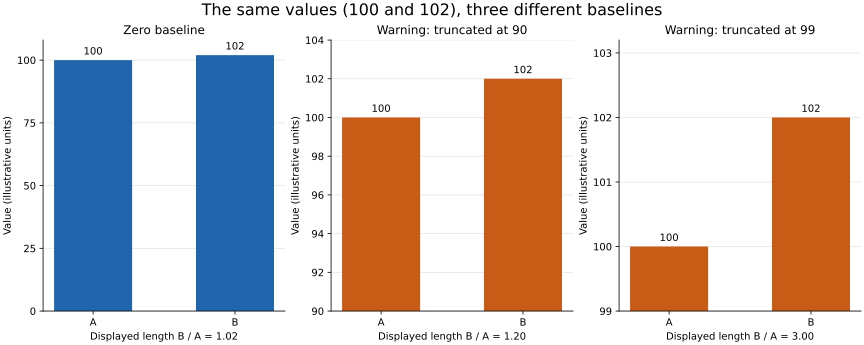

# Lesson 1: Principles of Effective Visualization

[Theory index](../README.md) · [Module overview](./README.md)

**Course:** Data Science and Analytics  
**Module VII:** Data Visualization  
**Estimated study time:** 50 minutes

## Learning objectives

- Explain how visual channels communicate data.
- Choose channels suited to the required comparison accuracy.
- Distinguish useful context from distracting decoration.
- Identify misleading axes, scales, time windows, and chart choices.
- Apply a chart-review checklist before publication.

## 1. Why visualisation works

A visual encoding maps a data value to a visible property, such as position, length, colour, or area.

Charts let readers inspect many observations together. Trends, isolated points, and groups can become easier to notice than when scanning a long table. Some differences in colour, orientation, and position can be detected rapidly with little deliberate attention; the course describes this as pre-attentive processing.

That does not mean every chart is instantly understood. Reading depends on the task, visual design, familiarity, labels, and the reader. A complicated plot can impose more effort than a small clear table.

| Task | Usually useful format | Reason |
| --- | --- | --- |
| Look for a trend across 1,000 daily sales values | Line chart | Encodes time and values in position |
| Find an unusual point among many paired records | Scatter plot | Makes separation from the main pattern visible |
| Look up March revenue to the dollar | Table | Provides the exact stored figure directly |
| Record four exact quarterly totals | Small table, possibly alongside a chart | Supports accurate lookup |
| Inspect the relationship between two numeric variables | Scatter plot | Shows arrangement, shape, and unusual cases |

**Rule of thumb:** charts support pattern recognition; tables support exact lookup. A chart can still include direct labels or an accompanying table when both tasks matter.

## 2. Choose visual channels deliberately

The lesson gives this simplified ranking for quantitative comparison:

| Course rank | Channel | Practical implication |
| --- | --- | --- |
| 1 | Position along a common scale | Strong choice for precise comparisons |
| 2 | Length from a shared baseline | Strong choice for comparing magnitudes |
| 3 | Angle / slope | Less suitable for precise magnitude comparisons |
| 4 | Area | Useful for broad impressions; harder to compare accurately |
| 5 | Colour / shade | Useful for categories and broad magnitude patterns; weak for exact reading |

Treat this as a task-oriented teaching guide rather than a universal ranking for all perception. Angle and slope are distinct judgements, and colour hue is not the same as luminance or shade.

Graphical-perception studies examine how encoding and presentation affect judgement accuracy; see [Heer and Bostock's research](https://idl.uw.edu/papers/crowdsourcing-graphical-perception).

### Put the central comparison in position or length

For five values that readers must compare accurately, use a dot plot on a common scale or bars with a zero baseline. Add exact labels or a table when readers need precise numbers.

A pie chart makes comparisons depend on angles and areas. It can communicate a small number of parts of a meaningful whole, but it is usually a poor choice for ranking near-equal values.

Independent batch average scores are not normally parts of one total. A pie of such averages has a semantic problem as well as a perceptual one.

### Colour and area still have useful roles

Colour can distinguish categories, highlight a selected series, or support a heatmap with a meaningful scale. Do not rely on colour alone when labels, symbols, or position can also identify groups.

Area can encode a rough quantity on a map. Scale circle area to the quantity, not radius: doubling the radius quadruples the area. Provide a legend and a more precise alternative if exact comparisons matter.

## 3. Data-ink and useful context

The data-ink ratio is the proportion of a chart's graphical ink devoted to representing data rather than non-data material. It is a design principle, not a requirement to count pixels or remove every supporting mark.

Remove elements that compete with interpretation without adding useful information:

- Decorative photographs behind the plotting area.
- Drop shadows on data marks.
- Unnecessary 3-D perspective for ordinary numeric bars.
- Heavy or excessive gridlines.
- Repeated labels that add clutter without helping the task.

Keep information readers need: units, scale, titles, sources, relevant annotations, and uncertainty where appropriate. Light gridlines can support reading; they are not automatically chart junk.

A plain chart without a meaningful axis can be less useful than one with a modest amount of supporting ink. The goal is clarity and faithful interpretation, not minimal decoration at any cost.

The [Government Analysis Function chart guidance](https://analysisfunction.civilservice.gov.uk/policy-store/data-visualisation-charts/) illustrates useful gridlines and numerical-axis choices.

## 4. Axes and scales can change the message

A bar's visible length represents magnitude, so standard magnitude bars should extend from zero on their numeric axis. For negative values, bars extend in the opposite direction from the same zero reference.

If a narrow difference needs emphasis, consider a clearly labelled dot plot or another position-based design rather than cropping magnitude bars.

A line chart or scatter plot does not require a zero baseline in every case: its main encoding is position. Choose and label its range so the variation and context remain clear. The bar-chart rule is not a blanket rule for every y-axis.

### The 100 versus 102 example

The actual relative increase is:

```text
(102 − 100) / 100 × 100 = 2%
```

| Bar baseline | Visible length for 100 | Visible length for 102 | Length ratio |
| --- | ---: | ---: | ---: |
| 0 | 100 | 102 | 1.02 |
| 90 | 10 | 12 | 1.20 |
| 99 | 1 | 3 | 3.00 |

Task 4 uses baseline 90; the earlier worked exercise uses 99. They are different distortions, not interchangeable calculations.

The raw values and absolute difference of 2 remain unchanged. Cropping changes the apparent ratio of bar lengths.



**Figure description:** with zero as the baseline, the bars have nearly equal lengths. With 90 as baseline, the 102 bar appears 20% longer; with 99, it appears three times as long. The orange panels are labelled as misleading demonstrations rather than recommended designs. The table supplies the exact plotted quantities.

## 5. Other ways charts can mislead

| Technique | Risk | Better approach |
| --- | --- | --- |
| Independently tuned dual axes | Aligning two unrelated scales can suggest a relationship | Use aligned panels or a justified common representation |
| Cherry-picked dates | A selected short window can hide a longer reversal or stable pattern | Explain the window and provide relevant wider context |
| Wrong chart type | A many-slice pie hides small differences; unrelated averages imply false parts of a whole | Match the chart to the statistical relationship |
| Unequal spacing for equal time steps, or vice versa | Distorts apparent rates of change | Encode elapsed time consistently |
| Unlabelled log or transformed scale | Changes how ratios and differences should be read | State the transformation and interpret it correctly |
| Decorative 3-D perspective | Perspective and occlusion change apparent size | Use an ordinary 2-D comparison |

A design can mislead unintentionally. Critique the effect on interpretation without assuming the designer intended to deceive.

## 6. Worked practice

### Practice 1 — Explain the perception shortcut

1. A line chart makes the overall trend, recurring cycles, and abrupt changes in 1,000 daily sales values easier to inspect than repeated table lookups.
2. A scatter plot is well suited to spotting a distant point, while a table is often faster for retrieving its exact recorded value.
3. The “computational shortcut” is that spatial arrangement makes relationships perceptible without calculating every comparison consciously.
4. A table is preferable when a reader needs a precise revenue figure or a short set of official totals.

Choose the format for the task rather than assuming a plot is always better.

### Practice 2 — Apply the channel ranking

| Proposed chart | Channel | Assessment and alternative |
| --- | --- | --- |
| Pie of five batch average scores | Angle and area | Averages do not form a meaningful whole; use a bar or dot plot |
| Time series drawn as a line | Position along scales; local slope shows change | Good for temporal patterns when time spacing and units are correct |
| Population circles on a map | Area | Suitable for a rough spatial impression; add a legend and a ranked comparison for precision |
| Revenue encoded only in colour shade | Shade | Poor for exact comparisons; use position or length with labels or a table |

The bar-over-pie recommendation follows from the accuracy of common-scale position and baseline length for magnitude comparisons.

### Practice 3 — Improve a cluttered chart

| Element | Decision | Reason |
| --- | --- | --- |
| Heavy dark gridlines at every interval | Remove or lighten | They compete with the marks; retain only useful reference lines |
| 3-D effect on ordinary bars | Remove | Perspective changes apparent dimensions and can hide values |
| Value labels | Keep selectively | Helpful for precise lookup if they remain readable |
| Decorative photograph | Remove | Distracts without explaining the quantities |
| Bar shadows | Remove | Add decoration without a needed comparison |
| Numeric scale and units | Keep | Necessary to interpret magnitude |

The reader gains a clearer hierarchy: data first, helpful context second. A real three-dimensional scientific quantity can justify a 3-D view; the issue here is decorative extrusion of ordinary bars.

### Practice 4 — Quantify truncated-bar distortion

[lesson01-visualization-demo.py](./lesson01-visualization-demo.py) computes the ratios and regenerates the figure.

Expected numerical output:

```text
Actual increase from 100 to 102: 2.0%
Baseline 0: displayed length ratio = 1.02
Baseline 90: displayed length ratio = 1.20
Baseline 99: displayed length ratio = 3.00
```

Inspect the numeric-axis origin when reviewing a bar chart. At baseline 99, the reader sees lengths 1 and 3 instead of lengths 100 and 102. Even correctly printed tick labels do not remove the conflict between bar length and full magnitude.

The course's “294% of the honest ratio” compares 3 with 1.02; it does not mean the original values differ by 294%. The direct ratios above are clearer.

### Practice 5 — A pre-publication checklist

- [ ] State the question, audience, and intended comparison.
- [ ] Encode the main quantity using an appropriate visual channel.
- [ ] Start ordinary magnitude bars at zero and show negative values correctly.
- [ ] Match the chart type to the relationship: time, rank, distribution, association, or part-to-whole.
- [ ] Label axes, units, transformations, and the relevant population and period.
- [ ] Retain useful scale references while removing distracting decoration.
- [ ] Explain the data source, aggregation, exclusions, and any important uncertainty.
- [ ] Check colour readability and avoid relying only on hue to distinguish groups.
- [ ] Add exact labels or a table when precise lookup matters.
- [ ] Review whether the selected scale, dates, or categories could mislead a reasonable reader.

**Applied critique:** no external recent chart was supplied, so use the baseline-99 panel above as a constructed example. Its worst flaw is representing a 2% value increase with a 3:1 visible bar-length ratio. It is labelled as a demonstration; a published magnitude comparison should use the zero-baseline panel or a clearly explained position-based alternative.

This avoids inventing a news example or claiming to have reviewed a chart that was never provided.

## 7. Reproduce the calculations and figure

The arithmetic demonstration uses Python's standard library. Plot generation additionally needs Matplotlib, whose tested version is recorded in [lesson01-requirements.txt](./lesson01-requirements.txt).

From this directory:

```powershell
python lesson01-visualization-demo.py
python lesson01-visualization-demo.py --plot
```

The --plot option creates lesson01-axis-comparison.svg and a PNG preview. The fixture uses illustrative units and is not a measured student, business, or financial dataset.

The helper calculates visible-length ratios only for finite positive-length comparisons with baseline < smaller value ≤ larger value. It is not a general chart-validation tool.

## 8. Theory exercises — suggested answers

These are study references. Explain the concepts in your own words for course submissions.

### Task 1 — Purpose of visual encoding

A table presents exact values for deliberate lookup and comparison. A visualisation maps values to properties such as position, length, colour, or area, allowing patterns to be inspected across many observations.

Rapid visual processing can make a trend, cluster, or unusual point easier to notice without reading every number. This reduces effort for pattern-finding tasks. Tables remain useful for exact figures, and a good presentation may use both.

### Task 2 — Rank visual channels

Prioritise **position along a common scale** because readers can compare aligned points accurately, and **length from a common baseline** because it supports direct magnitude comparison.

Avoid relying on **area** for the precise comparison because people judge relative areas less accurately. Also avoid using **colour shade alone** to communicate exact quantities because fine numerical differences are difficult to recover from colour.

A labelled dot or bar chart, with an accompanying table when needed, fits this task better.

### Task 3 — Data-ink ratio

The data-ink ratio describes the share of a chart's ink devoted to representing the data.

Three examples of removable chart junk are decorative background photographs, drop shadows, and unnecessary 3-D effects on bars. Photographs and shadows compete for attention without explaining the values; 3-D perspective can also distort their apparent size.

Removing these elements makes the comparison clearer. Keep useful labels, axes, and appropriately light reference lines rather than deleting all non-data context.

### Task 4 — Truncated y-axis

The values 100 and 102 differ by only 2%. With zero as the baseline, their bar lengths have ratio 102/100=1.02.

Starting the axis at 90 leaves visible lengths of 10 and 12. The second bar then looks 20% longer, with ratio 1.20, although the underlying value is only 2% greater.

Because a bar uses length to represent magnitude, cropping its baseline exaggerates the relative difference. Use a zero baseline for an ordinary bar comparison or choose a clearly labelled position-based chart.

### Task 5 — Other misleading techniques

1. **Dual axes with independently chosen scales:** the designer can make lines appear to rise and fall together by adjusting their separate axis ranges. Readers may infer a relationship from visual alignment that depends on the scale choices.
2. **Cherry-picked time windows:** showing only a favourable interval can hide a longer decline, reversal, or stable pattern. The displayed observations can be correct while the selection gives a distorted impression of the overall trend.

Use transparent scale choices and relevant context so readers can judge the claim.

## 9. Quick revision

- Match the format to the task: pattern recognition or precise lookup.
- Use common-scale position and baseline length for important quantitative comparisons.
- Treat the channel ranking as a guide, not a universal law.
- Preserve meaningful context while removing distraction.
- Start ordinary magnitude bars at zero.
- Do not apply the bar-baseline rule indiscriminately to every chart.
- Check scale choices, time windows, transformations, and implied relationships.
- Label deliberately misleading demonstrations clearly.

## Sources

- User-supplied course material: *Module VII: Data Visualization, Principles of Effective Visualization*.
- [Heer and Bostock: Crowdsourcing Graphical Perception](https://idl.uw.edu/papers/crowdsourcing-graphical-perception) — research on visual judgement and design.
- [Government Analysis Function: Data visualisation — charts](https://analysisfunction.civilservice.gov.uk/policy-store/data-visualisation-charts/) — chart design, helpful gridlines, and bar-axis guidance.

Worked responses, clarifying notes, calculations, and the comparison figure were prepared for this repository.

[Module overview](./README.md) · [Theory index](../README.md)
