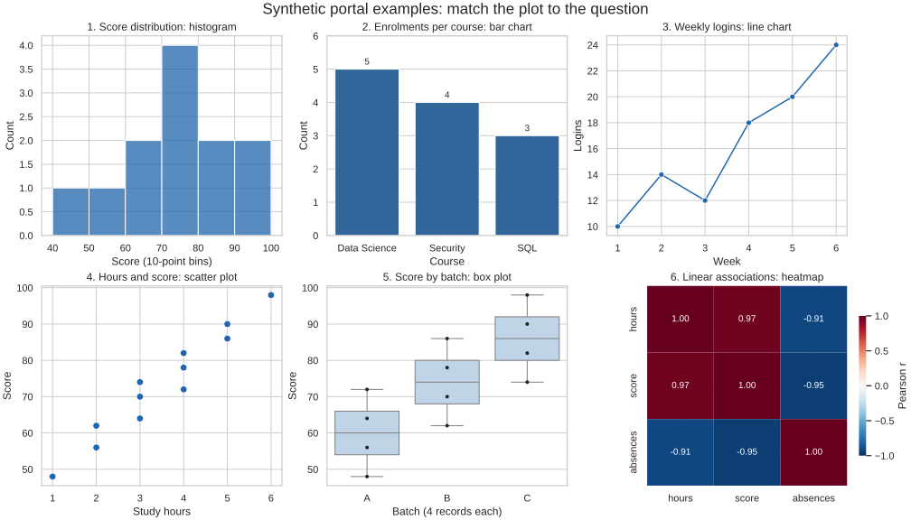

# Lesson 2: Choosing the Right Plot, and the Tools to Draw It

[Theory index](../README.md) · [Module overview](./README.md) · [Previous lesson](./Lesson-01-Principles-of-Effective-Visualization.md)

**Course:** Data Science and Analytics  
**Module VII:** Data Visualization  
**Estimated study time:** 55 minutes

## Learning objectives

- Match common plot types to the question and variable types.
- Distinguish numeric distributions from category comparisons.
- Explain what a plot displays and what it leaves out.
- Use Seaborn for statistical plotting and Matplotlib for customisation.
- Identify when interactive Plotly figures suit a deliverable.

## 1. Start with the question

Chart choice follows the intended comparison, not just a preferred visual style.

| Question | Natural starting plot | What it encodes |
| --- | --- | --- |
| How is one numeric variable distributed? | Histogram | Counts or density across numeric intervals |
| Which category has the largest value or count? | Bar chart | A quantity for each category |
| How does a quantity change over time? | Line chart | Position along an ordered time axis |
| How do two numeric variables relate? | Scatter plot | Paired observations in two dimensions |
| How do distributions differ across groups? | Box plots | Medians, quartiles, whiskers, and flagged extremes |
| Which numeric pairs have notable correlations? | Correlation heatmap | A matrix of pairwise coefficients |

These are useful starting choices rather than a one-to-one law. A dot plot can compare categories, an ECDF can show a distribution, and a small-multiple layout can improve a crowded time series.

Check the statistical unit before plotting. “Enrolments per course” counts enrolments; it does not necessarily count distinct people.

## 2. Histogram versus bar chart

| Feature | Histogram | Bar chart |
| --- | --- | --- |
| Underlying question | Distribution of a numeric variable | Comparison among categories |
| Numeric/category axis | Ordered numeric intervals | Distinct category labels |
| Typical mark arrangement | Adjacent bins with touching bars | Separate bars with gaps |
| Meaning of mark height | Count, frequency, or density as labelled | A specified category quantity or summary |
| Main design decision | Bin edges and summary scale | Category ordering and aggregation |

The semantic distinction is more reliable than the gaps. A histogram can be drawn with outlines, spaces, or a step style, and categorical bars can be drawn without gaps. Appearance alone does not determine the chart type.

Numeric values need not be continuously measured to use a histogram; integer scores and ages can also be binned. For a small number of distinct integer outcomes, a count plot may be clearer.

### Read bins correctly

Use non-overlapping bins. For example, [0,10) includes 0 but excludes 10, so the next bin can begin at 10 without double counting. NumPy histograms normally include the final right edge in the last bin.

Bin choices can change the apparent shape. Compare reasonable alternatives rather than using bins to manufacture a story.

For unequal bin widths, raw bar heights are not directly comparable as frequency per unit; a correctly defined density histogram makes area represent probability. The supplied examples use equal-width bins and labelled counts.

## 3. Count variables, identify types, then specify the task

| Variables | Question | Starting plot |
| --- | --- | --- |
| One numeric | What is its distribution? | Histogram or box plot |
| One categorical | How frequent are its categories? | Bar chart of counts |
| Two numeric | What is their relationship? | Scatter plot |
| Numeric plus categorical | How do values vary within and across groups? | Box plots |
| Numeric plus categorical | How do group means or totals compare? | Bar chart of the stated summary |
| Many numeric | Which linear associations merit inspection? | Correlation heatmap, then selected scatter plots |
| Numeric pair plus a grouping variable | Does the relationship differ by group? | Scatter plot with labelled colour, shape, or facets |

A box plot and a summary bar chart do not show the same thing. A salary bar chart might show only the mean per department; a box plot preserves information about within-department spread.

A **grouped bar chart** is useful when a second categorical dimension creates multiple summaries per main category. With department alone, a simple bar chart may suffice. The course groups both under the broader numeric-by-category choice.

A correlation heatmap does not reveal every relationship. Pearson coefficients can miss curves, as shown in Module 6.

## 4. Matplotlib, Seaborn, and Plotly

| Library | Strength emphasised in the lesson | Typical use |
| --- | --- | --- |
| Matplotlib | Fine control over figures, axes, labels, and annotations | Custom static layouts and publication figures |
| Seaborn | High-level statistical plotting built on Matplotlib | Standard EDA charts with convenient data mappings |
| Plotly | Interactive figures with hover and zoom | Browser-based exploration and dashboard figures |

This division is a workflow guide, not a restriction. Matplotlib supports interactive backends, Plotly can export static figures, and Seaborn's output can be customised. A plotting library also does not supply an entire deployed dashboard by itself.

### Seaborn to Matplotlib: the same figure

Axes-level Seaborn functions such as histplot and boxplot draw onto a Matplotlib Axes, which can be modified directly:

```python
fig, ax = plt.subplots()
sns.boxplot(data=df, x="batch", y="score", ax=ax)
ax.set(xlabel="Batch", ylabel="Score", ylim=(0, 100))
ax.set_title("Score distribution by batch")
fig.savefig("box.png")
plt.close(fig)
```

This is a workflow sketch requiring df, sns, and plt to be defined. The supplied script implements complete runnable examples.

Figure-level functions such as displot and catplot manage their own figure/grid. Customise the returned grid rather than assuming every Seaborn function returns an Axes. See the [Seaborn function overview](https://seaborn.pydata.org/tutorial/function_overview.html).

### Plotly for exploration

Hover labels can expose point values, while zooming helps readers focus on a date range. These are built-in figure interactions described in the [Plotly hover guide](https://plotly.com/python/hover-text-and-formatting/).

Choose interaction because it serves the audience's task. A quick static EDA box plot does not require an interactive framework, although Plotly is not inherently wrong if it already fits the workflow.

## 5. Offline gallery and reproducible code



[lesson02-plot-demo.py](./lesson02-plot-demo.py) uses a fixed synthetic twelve-record student fixture and a separate six-week login series. The examples illustrate chart choices, not findings about real students.

| Panel | Data and question |
| --- | --- |
| 1 | Score distribution in equal-width 10-point bins |
| 2 | Enrolment counts: Data Science 5, Security 4, SQL 3 |
| 3 | Weekly logins: 10, 14, 12, 18, 20, 24 |
| 4 | Paired study hours and scores |
| 5 | Score distributions for three batches, four records each |
| 6 | Pearson correlations among hours, score, and absences |

The box plot overlays observed points because there are few records. It uses the usual 1.5×IQR whisker convention; the endpoints need not be the minimum and maximum.

The numerical fixture is embedded in the script. No dataset download is needed.

### Run it

Install the versions recorded in [lesson02-requirements.txt](./lesson02-requirements.txt) in a suitable project environment, then run from this directory:

```powershell
python lesson02-plot-demo.py
```

The script writes:

- lesson02-plot-gallery.svg, the committed gallery above.
- lesson02-plot-gallery.png, a preview.
- hist.png, a standalone histogram.
- box.png, a standalone box plot.

Use --output-dir with a different directory if desired. Files with those names in the selected directory are regenerated.

The course's sns.load_dataset("tips") example uses an online sample repository and may need internet access on its first load; it is not necessarily bundled with the library. The [load_dataset documentation](https://seaborn.pydata.org/generated/seaborn.load_dataset.html) explains the online/cache behaviour. This lesson uses offline fixtures to keep reproduction independent of that download.

## 6. Worked practice

### Practice 1 — Map questions to plots

1. **Final-score distribution:** histogram, encoding counts across score intervals to inspect spread and skew.
2. **Most enrolments among four courses:** bar chart, encoding a count for each course.
3. **Weekly login change:** line chart, encoding values along a time-ordered axis.
4. **Study hours and scores:** scatter plot, encoding each paired observation.
5. **Scores across three batches:** box plots per batch, showing centre, spread, and flagged extremes; add observations for small groups.
6. **Correlation among many features:** heatmap of coefficients, followed by scatter plots for selected or domain-important pairs.

Stating the question prevents using a familiar chart that fails to display the required comparison.

### Practice 2 — Separate numeric bins from categories

| Task | Choice | Reason |
| --- | --- | --- |
| Students in score ranges 0–10, 10–20, and so on | Histogram | Ordered numeric intervals, with a consistent boundary rule |
| Students in named batches | Bar chart | Distinct categories with counts |
| Shape of ages | Histogram | Distribution of a numeric variable |
| Mean marks for four courses | Bar chart | A specified summary per category |

A histogram preserves the order and span of numeric bins. A category chart of selected summaries does not show the full underlying distribution.

Adjacent versus separated bars is a useful visual clue in standard designs, but the data meaning is the defining distinction.

### Practice 3 — Count and type variables

1. **Reaction time:** one numeric variable; use a histogram or box plot to inspect its distribution.
2. **Preferred payment method:** one categorical variable; count categories and draw bars.
3. **Height and weight:** two numeric variables; use a scatter plot.
4. **Salary by department:** one numeric and one categorical variable; use box plots for distributions or bars for clearly stated summaries.
5. **Add gender to height and weight:** use a grouping encoding such as colour plus labels, or facets, if relevant to the question and measured appropriately.

A third variable does not automatically improve a plot. Avoid encoding so many groups that the relationship becomes unreadable.

### Practice 4 — Draw standard plots with Seaborn

The runnable script uses:

```text
sns.histplot(data=students, x="score", bins=BINS, ax=ax)
sns.boxplot(data=students, x="batch", y="score", order=BATCHES, ax=ax)
```

It then uses Matplotlib to set titles and labels, save each figure, and close it.

The histogram answers a one-numeric-variable distribution question. The box plot answers a numeric-by-category distribution question. Seaborn is a convenient choice because these are standard statistical mappings; raw Matplotlib could also produce them.

The standalone files are hist.png and box.png. The gallery provides the same two plot types alongside four additional choices.

### Practice 5 — Match tools to deliverables

| Deliverable | Course choice | Justification |
| --- | --- | --- |
| Quick EDA box plot | Seaborn | Convenient standard statistical plot |
| Custom publication layout and annotations | Matplotlib | Direct control over figure and axes |
| Browser dashboard with hover values and date zoom | Plotly | Interactive figure behaviour |
| Quick correlation heatmap | Seaborn | Ready-to-use matrix colour encoding |

Start with Seaborn's high-level functions for the standard EDA task, then customise the underlying Matplotlib objects. A new figure does not need to be recreated in another library merely to change ticks or labels.

Plotly is discussed here as a tool choice; this lesson does not implement or publish a dashboard.

## 7. Theory exercises — suggested answers

Use these as study references and explain the reasoning in your own words for course submissions.

### Task 1 — Temperature over ten years

Use a line chart, with time on the horizontal axis and temperature on the vertical axis. The ordered positions and connected observations show how temperature changes over time.

State the time resolution and aggregation, such as monthly mean temperature, so readers know what each point represents. A trend and seasonal variation may require different summaries.

### Task 2 — Histogram versus bar chart

A histogram shows the distribution of a numeric variable by dividing its range into ordered bins and showing a count or density for each interval. Its bars normally touch because the numeric intervals are adjacent.

A bar chart compares values across distinct categories, with category labels on its category axis and usually gaps between bars. The key difference is numeric intervals versus categories, not just whether the bars happen to touch.

### Task 3 — Department and salary

The two course choices are:

1. A **box plot per department**, to compare salary distributions, medians, and spread.
2. A **bar chart of a defined salary summary**, such as mean or median salary per department. Use grouped bars if another categorical variable creates multiple summaries per department.

The box plot shows within-department variation; a summary bar alone does not.

### Task 4 — Interactive dashboard library

Use Plotly for the figure layer because it supports hover information and interactive zooming suited to browser-based exploration.

Matplotlib and Seaborn are strong options for static figures and EDA, but Plotly provides these web-oriented interactions directly. The full dashboard still needs a surrounding application or page and appropriate data handling.

### Task 5 — Plotting workflow

Begin with an axes-level Seaborn function to generate the standard statistical plot quickly. Keep the Matplotlib Axes returned by the function, or create an Axes and pass it through ax=.

Then use Matplotlib methods to adjust tick locations, labels, limits, titles, and annotations on that same figure. This works because Seaborn is built on Matplotlib, so the initial high-level choice does not prevent detailed customisation.

## 8. Quick revision

- Name the question before choosing a plot.
- Identify variable types and the observational unit.
- Use histograms for numeric distributions and bars for category comparisons.
- Do not identify a chart solely by gaps between bars.
- Distinguish a group distribution from a group summary.
- Keep time ordering, bin boundaries, and aggregation explicit.
- Use Seaborn and Matplotlib together for standard plots and fine control.
- Choose Plotly when interactive figure behaviour serves the deliverable.

## Sources

- User-supplied course material: *Module VII: Data Visualization, Choosing the Right Plot, and the Tools to Draw It*.
- [Seaborn: Function overview](https://seaborn.pydata.org/tutorial/function_overview.html) — axes-level and figure-level workflow.
- [Seaborn: load_dataset](https://seaborn.pydata.org/generated/seaborn.load_dataset.html) — online sample datasets and caching.
- [Plotly: Hover text and formatting](https://plotly.com/python/hover-text-and-formatting/) — interactive hover values.

Worked responses, clarifying notes, offline fixtures, and the plot gallery were prepared for this repository.

[Previous lesson](./Lesson-01-Principles-of-Effective-Visualization.md) · [Module overview](./README.md) · [Theory index](../README.md)
