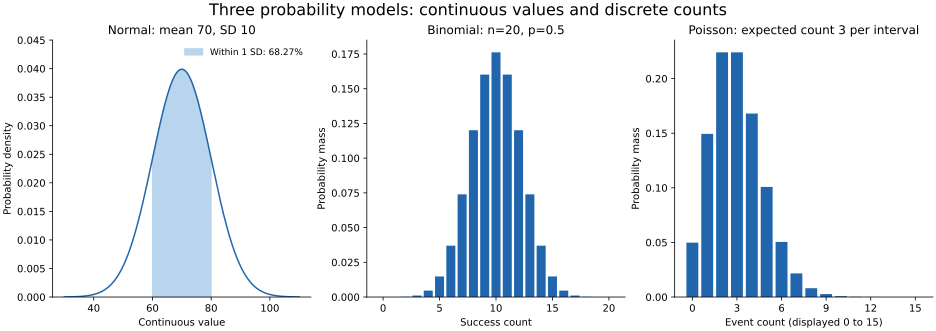

# Lesson 1: Probability Fundamentals and Key Distributions

[Theory index](../README.md) · [Module overview](./README.md)

**Course:** Data Science and Analytics  
**Module VIII:** Review of Probability and Statistics  
**Estimated study time:** 55 minutes

## Learning objectives

- Apply complement, addition, and multiplication rules.
- Calculate conditional probabilities and distinguish their direction.
- State when events are independent.
- Choose normal, binomial, or Poisson models from a process and its assumptions.
- Interpret the normal empirical rule without treating it as universal.

## 1. Basic probability rules

| Rule | Formula | Important condition |
| --- | --- | --- |
| Range | 0 ≤ P(A) ≤ 1 | All events |
| Complement | P(not A) = 1 − P(A) | A and its complement exhaust the sample space |
| Addition | P(A or B) = P(A) + P(B) − P(A and B) | “Or” is inclusive |
| General multiplication | P(A and B) = P(A given B) × P(B) | The conditional expression requires P(B)>0 |
| Independent multiplication | P(A and B) = P(A) × P(B) | Only if A and B are independent |

The addition rule subtracts the overlap because it was counted twice. For mutually exclusive events the overlap is zero, so their probabilities simply add.

Mutual exclusivity and independence are different. Two disjoint events with positive probabilities cannot be independent: if one happens, the other cannot.

### “At least one” through the complement

```text
P(at least one failure) = 1 − P(no failures)
```

This identity does not require independence. Independence is needed when calculating “no failures” as a product of separate success probabilities.

For n independent trials with the same failure probability p:

```text
P(no failures) = (1 − p)^n
P(at least one failure) = 1 − (1 − p)^n
```

Common-cause failures can make the independence assumption unsuitable for an actual server cluster.

The course uses 0 as “impossible” and 1 as “certain.” More precisely, continuous models can assign probability zero to any particular exact value even though observations still take specific values. Distinguish an event's probability from logical impossibility.

## 2. Conditional probability and independence

For P(B)>0:

```text
P(A given B) = P(A and B) / P(B)
```

Conditioning restricts the reference population to cases where B holds. It does not by itself assert that B causes A.

A and B are independent when P(A and B)=P(A)P(B). Equivalently, when P(B)>0, P(A given B)=P(A).

For more than two events, pairwise independence is not always enough to multiply every event's probability; the repeated-trial examples assume mutual independence.

### The direction matters

```text
P(fraud given flagged) ≠ generally P(flagged given fraud)
```

The first asks about fraud among alerts. The second asks about alerts among fraud cases. Their denominators differ.

Bayes' rule connects the directions:

```text
P(A given B) = P(B given A) × P(A) / P(B)
```

A rare underlying event can have a low probability among positive alerts even when detection sensitivity is high.

## 3. Three distribution families

A distribution assigns probability to a random variable's possible values. Match the model to the process, then check whether its assumptions are credible.

| Model | Variable and parameters | Mean and variance | Assumptions or cautions |
| --- | --- | --- | --- |
| Normal | Continuous; mean μ and SD σ>0 | Mean μ; variance σ² | Symmetric bell-shaped model, not every continuous variable |
| Binomial | Success count; n trials and common success probability p | Mean np; variance np(1−p) | Fixed n, binary outcomes, independent trials, constant p |
| Poisson | Event count in a specified interval; expected count λ | Mean λ; variance λ | A constant-rate independent-arrival process is a standard justification |

### Normal: a density, not a probability per point

The normal curve is symmetric and extends over all real values. Probabilities are areas under the density over intervals. A curve's height is not the probability of observing that exact value.

Adult heights in a relatively homogeneous population and some measurement errors can be approximately normal. Mixed populations, bias, heavy tails, or physical bounds can make a normal model unsuitable. Measurement error is centred at zero only when the instrument/process is unbiased.

The central limit theorem helps explain normal approximations for averages under suitable conditions, such as independent, identically distributed observations with finite variance and a sufficiently large sample. It does not make all raw data normal.

### Binomial: a fixed number of trials

Counting heads in 20 independent fair flips gives n=20 and p=0.5. Counting defective bulbs in a fixed batch is a binomial candidate if defect outcomes are independent with a common probability.

Sampling without replacement from a finite population can require a different model. Shared manufacturing problems can also make defects dependent.

### Poisson: counts over an interval

For an expected rate r events per unit time over duration t, λ=r×t. λ is the expected count for the actual interval, not a unit-free rate detached from time.

Poisson counts need not be small, and “rare events” is not the defining requirement. Strong clustering, time-varying intensity, or variance much larger than the mean can make a simple Poisson model inadequate.



The panels are theoretical examples, not fitted real-world data. The normal panel shades the central one-SD region. The Poisson panel displays counts 0–15, while its support continues indefinitely.

## 4. The normal empirical rule

For an exactly normal variable:

| Interval | Probability within |
| --- | ---: |
| μ ± 1σ | About 68.27% |
| μ ± 2σ | About 95.45% |
| μ ± 3σ | About 99.73% |

The familiar shorthand is 68–95–99.7.

About 0.27% lies outside ±3σ, **combining both tails**; each tail contains about 0.135%. This is an interval-tail probability, not the probability of one exact continuous value.

A three-SD flag can therefore indicate an unusual value under an appropriate normal reference. It is not proof of an error. Large datasets can contain many such observations naturally.

Do not transfer this normal-model frequency directly to skewed or heavy-tailed data, or to small-sample self-standardised z-scores. Module 6 showed how estimating the reference from the same small dataset can mask extremes.

## 5. Worked practice

### Practice 1 — At least one failed login

For 50 independent logins, each with failure probability 0.02:

```text
P(none) = 0.98^50 = 0.36416968...
P(at least one) = 1 − 0.98^50 = 0.63583032...
```

Rounded to four decimal places, the probabilities are 0.3642 and 0.6358.

A direct calculation would sum the binomial probabilities for 1 through 50 failures. The complement computes the same event with one subtraction.

The source's 50-logins-in-an-hour example has fixed trial count, making this a binomial-style calculation; it is not automatically a Poisson process just because an hour is mentioned.

### Practice 2 — Fraud given a flag

| Actual class | Flagged | Not flagged | Total |
| --- | ---: | ---: | ---: |
| Fraud | 18 | 2 | 20 |
| Legitimate | 300 | 9,680 | 9,980 |
| Total | 318 | 9,682 | 10,000 |

```text
P(fraud) = 20 / 10000 = 0.002 = 0.2%
P(fraud given flagged) = 18 / 318 ≈ 0.056604 = 5.66%
P(flagged given fraud) = 18 / 20 = 0.9 = 90%
```

The conditional fraud probability is about 28.3 times the base rate, but most alerts are still legitimate logins.

Alert reviewers care about fraud probability among alerts; detector evaluation also needs the detection rate, missed frauds, false-positive rate, workload, and consequences. One probability does not answer every operational question.

### Practice 3 — The hypothetical rare-disease test

This is a teaching calculation using stipulated probabilities, not guidance for interpreting any real medical test.

Assumptions: prevalence 1 in 1,000, sensitivity 99%, and specificity 99%. The phrase “99% accurate” alone is insufficient; the exercise explicitly supplies both conditional performance rates.

Expected counts in 100,000 people:

| Actual state | Positive | Negative | Total |
| --- | ---: | ---: | ---: |
| Disease | 99 | 1 | 100 |
| No disease | 999 | 98,901 | 99,900 |
| Total | 1,098 | 98,902 | 100,000 |

```text
P(disease given positive) = 99 / 1098 ≈ 0.090164 = 9.02%
P(positive given disease) = 99 / 100 = 99%
```

These are expected counts under the model, not a prediction that every population will realise exactly those numbers. The large disease-free group creates many false positives despite its small false-positive probability.

The low base rate changes the probability among positives; it does not change the stipulated sensitivity.

### Practice 4 — Choose distributions and parameters

| Scenario | Course model | Parameters and qualifications |
| --- | --- | --- |
| Heights of 500 adult men | Approximately normal | μ and σ for the relevant population; 500 is sample size, not a normal parameter |
| Heads in 20 coin flips | Binomial | n=20, p=0.5 if fair and independent |
| Support tickets per hour | Poisson candidate | λ expected per hour, if the rate/arrival assumptions fit |
| Instrument measurement error | Normal candidate | μ error bias, σ spread; μ=0 only if unbiased |
| Defects among 100 items, probability 3% each | Binomial | n=100, p=0.03 with independent constant-probability outcomes |
| Meteors observed per hour | Poisson candidate | λ per observation interval; check rate changes and clustering |

The data type and generating process suggest a model; neither a familiar label nor a rough visual resemblance proves the fit.

### Practice 5 — Verify the empirical rule

[lesson01-probability-demo.py](./lesson01-probability-demo.py) simulates 100,000 draws from a normal distribution with μ=70 and σ=10 using a local seeded random generator.

It compares simulated fractions within one, two, and three SDs with the theoretical normal probabilities, calculated using the error function. Simulation results fluctuate and should be close rather than identical.

The simulation measures distance from the known generating μ and σ. Replacing them with sample estimates changes the exact finite-sample problem.

A point outside three known SDs is unusual under the model, but a flag is a reason to investigate its context rather than delete it.

## 6. Reproduce the calculations and plots

The script uses Python's standard library for the probability calculations, small binomial/Poisson probability-mass functions, and simulation. Fractions are used for the fixed-count examples.

From this directory:

```powershell
python lesson01-probability-demo.py
python lesson01-probability-demo.py --plot
```

Plot generation additionally requires Matplotlib, whose tested version is recorded in [lesson01-requirements.txt](./lesson01-requirements.txt). The plotting option generates the committed SVG and a PNG preview.

The small PMF functions illustrate the formulas for these fixtures; they are not designed as numerically optimised routines for extremely large parameters.

## 7. Theory exercises — suggested answers

Use these as study references and explain the reasoning in your own words for course submissions.

### Task 1 — Complement rule for server failures

Instead of adding the probabilities of exactly one, two, and so on up to ten server failures, calculate the probability that none fails and subtract it from one:

```text
P(at least one server failure) = 1 − P(no server failures)
```

If all ten servers fail independently with the same weekly failure probability p, this becomes 1−(1−p)^10. If failures are dependent, the complement identity still holds, but the no-failure probability needs a model that accounts for their dependence.

### Task 2 — Conditional probability and independence

Conditional probability P(A given B) describes the probability of A within cases where B occurred. Independence is a property of events: knowing B does not change A's probability, so P(A given B)=P(A) when P(B)>0.

**Independent example:** heads on the first and second flips of a stipulated independent fair coin. Knowing the first result leaves the probability of heads on the second at one half.

**Dependent example:** drawing two cards without replacement. If the first card is an ace, there are only three aces left among 51 cards, so the chance that the second is an ace changes from 4/52 to 3/51.

### Task 3 — Reversing a conditional probability

P(positive test given disease) measures how often the test is positive among people with the disease. P(disease given positive test) measures how many positive results belong to people with the disease.

The second depends on prevalence, or the base rate, as well as test sensitivity and false-positive probability. For a rare disease, the much larger disease-free group can generate more false positives than true positives.

In the lesson's hypothetical example, sensitivity is 99% but the expected disease probability among positives is about 9.02%. The probabilities use different denominators and cannot be interchanged.

### Task 4 — Distribution selection

1. **Complaints per hour: Poisson**, as a starting count model if arrivals have a reasonably stable rate and suitable independence assumptions. λ is the expected hourly count.
2. **Defective bulbs among 50: binomial**, with n=50 and defect probability p, assuming independent bulbs with the same defect probability.
3. **Precise gold-bar weights: approximately normal**, if weights vary symmetrically around a process target under a stable production process. Parameters are the mean μ and SD σ; check calibration, shape, and process conditions rather than assuming every continuous measurement is normal.

These are the course's natural candidate models, not guaranteed descriptions of every real dataset.

### Task 5 — Normal empirical rule

For a normal distribution, about 68% of observations fall within one SD of the mean, about 95% within two, and about 99.7% within three.

About 0.27%, commonly rounded to 0.3%, lies more than three SDs away in the two tails combined. This low tail probability motivates a three-SD screening rule when the normal reference is appropriate.

Such a flag indicates rarity under the model, not certainty that the observation is wrong. The rule needs care with nonnormal data and when the reference statistics are estimated from a small sample.

## 8. Quick revision

- Use the complement for “at least one.”
- State independence before multiplying marginal probabilities.
- Distinguish mutually exclusive events from independent ones.
- Keep conditional-probability denominators explicit.
- Base rates matter for probabilities among alerts or positives.
- Normal models describe continuous values; binomial and Poisson describe counts.
- State distribution parameters and interval units.
- Treat the normal empirical rule as model-specific.
- Rare does not mean erroneous.

## Sources

- User-supplied course material: *Module VIII: Review of Probability and Statistics, Probability Fundamentals and Key Distributions*.
- [NIST: Normal distribution](https://www.itl.nist.gov/div898/handbook/eda/section3/eda3661.htm).
- [NIST: Binomial distribution](https://www.itl.nist.gov/div898/handbook/eda/section3/eda366i.htm).
- [NIST: Poisson distribution](https://www.itl.nist.gov/div898/handbook/eda/section3/eda366j.htm).

Worked responses, clarifying notes, calculations, and theoretical distribution plots were prepared for this repository.

[Module overview](./README.md) · [Theory index](../README.md)
