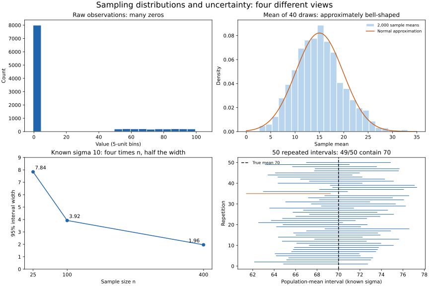

# Lesson 2: Sampling, the Central Limit Theorem and Confidence Intervals

[Theory index](../README.md) · [Module overview](./README.md) · [Previous lesson](./Lesson-01-Probability-Fundamentals-and-Key-Distributions.md)

**Course:** Data Science and Analytics  
**Module VIII:** Review of Probability and Statistics  
**Estimated study time:** 55 minutes

## Learning objectives

- Compare common sampling methods and their bias risks.
- Explain why sample size does not automatically repair selection bias.
- State a suitable version of the central limit theorem.
- Distinguish observation spread from the standard error of a mean.
- Interpret confidence intervals and sample-size effects correctly.

## 1. Population, sample, and target

A **population** is the group or process about which a question is asked. A **sample** contains the observations actually measured.

Sampling can reduce cost, time, and burden or make an otherwise impractical measurement possible. Specify the target population, the sampling frame, selection procedure, and nonresponse before making population claims.

A large sample can have small random error while retaining systematic bias. Collecting more volunteers through the same unrepresentative channel does not automatically recover the people the channel misses.

Probability sampling supports design-based inference, but no realised sample is guaranteed to match every population characteristic exactly. Good design and clear reporting matter alongside size.

### Common methods

| Method | How it works | Main caution |
| --- | --- | --- |
| Simple random sampling | Every fixed-size subset has the same selection probability | Needs a suitable frame; nonresponse can still create problems |
| Stratified sampling | Divide the population into strata and randomly sample within them | Allocation need not be proportional; weights may be needed |
| Systematic sampling | Choose a random start, then every k-th unit | Ordering and periodic patterns can affect the design |
| Convenience sampling | Include readily available units | Selection may be related to the outcome |

Equal individual inclusion probabilities alone do not fully define simple random sampling. Systematic sampling can have equal inclusion probabilities while allowing a different set of possible samples.

The course's “guaranteed proportional representation” is a possible stratified allocation, not the definition of every stratified design. See [Statistics Canada's probability-sampling guide](https://www150.statcan.gc.ca/n1/edu/power-pouvoir/ch13/prob/5214899-eng.htm).

## 2. Bias versus random sampling variation

| Issue | Meaning | Effect of increasing n under the same design |
| --- | --- | --- |
| Sampling variation | Different random samples give different estimates | Usually decreases under an appropriate design |
| Selection bias | The selection mechanism systematically favours some cases | Does not generally disappear |
| Nonresponse or coverage bias | Eligible people are missing from the frame or responses | More responses of the same kind need not correct it |
| Measurement bias | Responses or instruments systematically mismeasure the quantity | More observations can reproduce the same error |

Convenience samples may be useful for exploration or for describing the observed participants. Generalising them requires assumptions and evidence beyond their size.

Avoid claiming that a flawed sample makes every computed number meaningless. Its summaries may accurately describe that sample while failing to support the intended population inference.

The historical poll anecdote in the course is not needed to establish this principle and is not treated here as a verified single-cause account.

## 3. The central limit theorem

For independent, identically distributed observations with finite mean μ and finite, positive variance σ²:

```text
As n grows:
(sample_mean − μ) / (σ / sqrt(n)) approaches a standard normal distribution.

For sufficiently large n:
sample_mean is approximately normal with mean μ and variance σ²/n.
```

It is the **sampling distribution of the mean** that becomes approximately normal. Individual observations retain their original distribution.

“Repeat the sampling and collect the means” is a way to visualise this distribution. The theorem is not merely a claim that averaging an arbitrary collection of already-computed means always produces normal data.

### What the CLT does and does not promise

- Approximation quality depends on the source distribution and sample size.
- There is no universal sample size that works equally well for all distributions.
- Dependence, extreme tails, or infinite variance can invalidate this simple form.
- Normal raw data give an exactly normal mean for every n, under independent sampling.
- The CLT does not remove sampling bias or prove representativeness.

The standard deviation of the sampling distribution is the **standard error**:

```text
SE(sample_mean) = σ / sqrt(n)
```

SD describes variation among individual observations; SE describes variation among estimates across repeated samples. They answer different questions.

## 4. Confidence intervals

A confidence interval is a range produced by a procedure intended to cover a population parameter at a specified long-run rate.

A frequentist 95% CI means that, under the procedure's assumptions, about 95% of intervals generated by repeated sampling contain the fixed true parameter. Once this sample is observed, its realised interval either contains the parameter or does not.

It is not, under this interpretation, a 95% probability statement about the fixed parameter being inside this specific realised interval. A Bayesian credible interval has a different interpretation and requires a probability model and prior.

### CI for a mean: state the method

For independent normal observations with **known population SD**:

```text
sample_mean ± z_0.975 × σ / sqrt(n)
z_0.975 ≈ 1.96
```

When σ is unknown, the conventional normal-population interval uses the **sample SD** and a t critical value:

```text
sample_mean ± t_(0.975,n−1) × s / sqrt(n)
```

Large-sample approximations can also be useful under suitable conditions. The source's use of sample pstdev with a fixed 1.96 multiplier is an approximation, not a universal exact 95% CI. When estimating variability from a sample, st.stdev uses the conventional n−1 denominator.

Survey weights, clustered sampling, dependence, and finite-population sampling can require different SE calculations. For the 60-of-400 example, a sampling-without-replacement design may warrant a finite-population correction.

See [NIST's confidence-limit guidance](https://www.itl.nist.gov/div898/handbook/eda/section3/eda352.htm) for interpretation and the t-interval form.

### A narrow interval is not proof of a correct conclusion

A narrow CI expresses greater precision under the stated method. It does not account automatically for measurement error, selection bias, or a wrong model. A precise estimate can still be biased.

A CI for a population mean also does not describe the range containing 95% of individual observations. That requires a different question and interval.

## 5. Worked practice

### Practice 1 — Diagnose the sampling plans

| Plan | Method / risk | Would more of the same fix it? |
| --- | --- | --- |
| Only voluntary email replies for satisfaction | Self-selection and possible nonresponse bias | Not automatically |
| Luxury-mall shoppers for national income | Convenience and coverage bias | No general repair from size alone |
| Only course completers for difficulty | Survivorship/selection bias; dropouts are excluded | No |
| Every tenth name after a random shuffle of the full roster | Systematic selection with randomised order | A reasonable probability design if implemented correctly |

Dropout exclusion may understate difficulty if those students left because they struggled, but the direction should be investigated rather than assumed from the word “dropout.”

For the roster design, include a random start and check frame completeness. Randomisation reduces systematic selection patterns; it does not guarantee every subgroup matches its population proportion in the realised sample.

### Practice 2 — Simulate nonnormal observations and their means

The source draws zero with probability 0.8; otherwise it draws an integer uniformly from 50 through 100 inclusive.

Its true mean and variance can be calculated:

```text
E(X) = 0.8×0 + 0.2×75 = 15
Var(X) = 943.333333...
SD(X) ≈ 30.71373
SE(mean of 40) = SD(X)/sqrt(40) ≈ 4.85627
```

[lesson02-sampling-demo.py](./lesson02-sampling-demo.py) repeats samples of size 40 two thousand times with a local seeded generator. It compares the empirical mean and SD of those means with the theoretical quantities.

The sample-mean histogram is much more bell-shaped than the raw source, although finite-sample skewness and discreteness remain possible. The simulation illustrates the CLT; it does not prove a general theorem by itself.



**Figure description:** the upper panels contrast a source with many zeros and a much smoother distribution of size-40 means. The lower panels show theoretical CI widths falling with n and 50 simulated intervals against a fixed true mean. The raw-data panel uses equal-width five-unit bins and displays counts; the sample-mean panel displays density.

### Practice 3 — Interpret mean 70 minutes, 95% CI [66,74]

| Statement | Verdict | Explanation |
| --- | --- | --- |
| “There is a 95% probability the true mean lies in this realised interval” | Incorrect in the stated frequentist interpretation | Coverage is a property of the repeated procedure |
| “About 95% of intervals from repeated use of the method contain the true mean” | Correct under the assumptions | This is long-run coverage |
| “95% of students finish between 66 and 74 minutes” | Incorrect | The interval concerns the mean, not individual times |
| “A narrower interval is more precise” | Correct for the same parameter and comparable method | Precision does not rule out bias |

The individual-times error can badly understate how much students differ even when their average is estimated precisely.

### Practice 4 — Compare interval widths

For a fixed known σ=10 and a normal-based 95% interval:

```text
Width = 2 × z_0.975 × 10 / sqrt(n)
```

| n | SE | Width, rounded |
| --- | ---: | ---: |
| 25 | 2.0 | 7.84 |
| 100 | 1.0 | 3.92 |
| 400 | 0.5 | 1.96 |

Quadrupling n halves the width when spread, confidence level, and the independent-sampling design are held fixed.

When separate random samples supply estimated SDs, realised widths need not decrease monotonically. A t critical value also changes with n. The fourfold rule is an important planning relationship, not a guarantee for every pair of realised intervals or every sampling design.

The script uses known σ for the clean width comparison and repeated normal-sample coverage illustration.

### Practice 5 — Report 60 of 400 students honestly

The prompt supplies n=60, population size 400, and a sample mean of 5.2 hours. It does **not** supply the observations or SD, sampling design, or response details, so numerical CI endpoints cannot be calculated honestly.

A defensible report is:

> Among the 60 observed students from the 400 enrolled, reported weekly study time averaged 5.2 hours. The selection and response process must be documented before generalising to all students. A confidence interval is not yet available because the variability and design information needed to estimate the standard error have not been supplied.

To complete it, obtain the sample values or relevant variability estimate, explain selection and nonresponse, choose a design-appropriate interval, and report its method and limitations.

The course's suggested [4.6,5.8] bounds are illustrative, not derivable from the supplied facts. Do not present them as calculated results.

If someone wants to treat 5.2 as exact, explain that it is a sample estimate subject to sampling and other errors; the missing uncertainty information needs resolving before a strong claim.

## 6. Reproduce the examples

The numerical script uses Python's standard library for source moments, seeded simulations, and normal critical values:

```powershell
python lesson02-sampling-demo.py
python lesson02-sampling-demo.py --plot
```

Plotting additionally uses the Matplotlib version in [lesson01-requirements.txt](./lesson01-requirements.txt). The plotting option generates the committed SVG and a PNG preview.

The confidence-interval simulation uses independent normal draws with known μ=70 and σ=10. It demonstrates that procedure's coverage, not the validity of every interval on arbitrary survey data. A finite run need not cover exactly 95% of the time.

No real student survey or confidence interval is inferred from these synthetic demonstrations.

## 7. Theory exercises — suggested answers

Use these as study references and explain the ideas in your own words for course submissions.

### Task 1 — Simple random versus convenience sampling

Simple random sampling selects from a defined frame so every possible fixed-size sample has the same chance of selection. It supports population inference when the design and response process are handled appropriately.

Convenience sampling includes people who are easy to reach, such as readily available volunteers. They may differ systematically from the target population, creating bias. A large convenience sample can therefore give a precise description of its respondents without accurately representing everyone.

### Task 2 — Size versus representativeness

Increasing sample size mainly reduces random sampling variation under a suitable design. It does not automatically change who the selection mechanism includes or excludes.

If a method systematically misses part of the population, several thousand similarly selected participants can preserve the same bias. Improve the sampling and response design rather than assuming size alone repairs it.

### Task 3 — Explain the CLT

For independent, identically distributed observations with finite mean and finite positive variance, the standardised sample mean approaches a standard normal distribution as sample size grows.

This allows an approximately normal sampling distribution for the mean even when the raw observations are not normal. It supports appropriately constructed inference about means, while leaving the original data distribution unchanged. The conditions and approximation quality still matter.

### Task 4 — Interpret a 95% CI

A 95% confidence procedure would produce intervals containing the fixed true population mean about 95% of the time over repeated valid sampling.

After one sample is observed, the realised interval either includes that mean or does not. The 95% refers to the procedure's long-run coverage, not a posterior probability assigned to the fixed mean within this particular interval.

This interpretation depends on the interval method and sampling assumptions being suitable.

### Task 5 — Compare the two intervals

Result A, [69,71], has width 2. Result B, [55,85], has width 30. Both are centred at 70, but A is much more precise under comparable valid methods, while B communicates substantially greater sampling uncertainty.

Neither interval means that 95% of individual observations fall inside it. A narrower interval also does not prove freedom from sampling bias or measurement error, so the sampling method and assumptions remain important.

## 8. Quick revision

- Define the population and how the sample was obtained.
- A larger sample does not automatically remove bias.
- Stratification and systematic sampling require explicit design choices.
- The CLT concerns a sampling distribution under conditions.
- SD describes observations; SE describes an estimator's variation.
- A CI's confidence level describes procedure coverage.
- Use known-σ, t, or design-based methods as appropriate.
- Hold assumptions fixed when applying the square-root sample-size rule.
- Do not invent uncertainty bounds when variability and design information are missing.

## Sources

- User-supplied course material: *Module VIII: Review of Probability and Statistics, Sampling, the Central Limit Theorem and Confidence Intervals*.
- [Statistics Canada: Probability sampling](https://www150.statcan.gc.ca/n1/edu/power-pouvoir/ch13/prob/5214899-eng.htm) — sampling-design distinctions.
- [NIST: Normal distribution](https://www.itl.nist.gov/div898/handbook/eda/section3/eda3661.htm) — sampling-distribution context.
- [NIST: Confidence limits for the mean](https://www.itl.nist.gov/div898/handbook/eda/section3/eda352.htm) — coverage interpretation and t intervals.

Worked responses, clarifying notes, calculations, and simulation plots were prepared for this repository.

[Previous lesson](./Lesson-01-Probability-Fundamentals-and-Key-Distributions.md) · [Module overview](./README.md) · [Theory index](../README.md)
