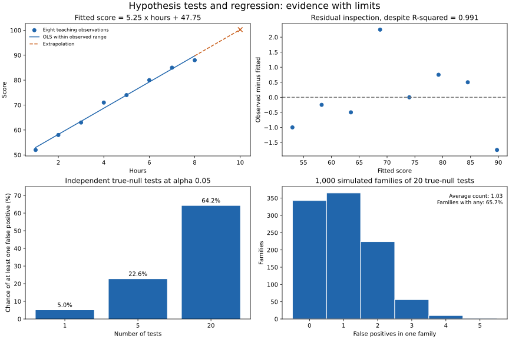

# Lesson 3: Hypothesis Testing, and Linear Regression

[Theory index](../README.md) · [Module overview](./README.md) · [Previous lesson](./Lesson-02-Sampling-CLT-and-Confidence-Intervals.md)

**Course:** Data Science and Analytics  
**Module VIII:** Review of Probability and Statistics  
**Estimated study time:** 55 minutes

## Learning objectives

- State null and alternative hypotheses for a defined outcome.
- Interpret a p-value under its model assumptions.
- Distinguish statistical significance from effect size and practical importance.
- Explain multiple-testing and selective-reporting risks.
- Fit and interpret a simple regression with an intercept.
- Keep association, prediction, and causation separate.

## 1. Hypothesis-testing logic

A hypothesis test compares an observed statistic with what its reference model predicts under a specified null hypothesis.

| Term | Meaning |
| --- | --- |
| Null hypothesis, H0 | A specified parameter value or set of values being tested |
| Alternative, H1 | The competing values or direction of interest |
| Test statistic | A summary chosen to measure departure from H0 |
| p-value | Under H0 and the test assumptions, probability of a statistic at least as extreme as observed |
| Significance level, α | A prechosen false-rejection criterion for the testing procedure |

The null is often “no difference,” but it is not always a universal no-effect claim. Equivalence and noninferiority questions, for example, use other formulations.

State the estimand, population, sampling or assignment design, alternative direction, and test before looking for a desirable result. A small p-value can reflect incompatibility with the full reference model, including assumptions; it does not uniquely diagnose which explanation is correct.

At a stated α such as 0.05, use the test's prespecified rejection rule. This lesson uses p<α. Failing to reject is different from establishing equality.

A test does not mechanically settle “real effect versus chance.” Report the effect estimate, uncertainty, design, and context alongside the test result.

## 2. What a p-value does not mean

For p=0.03:

| Interpretation | Assessment |
| --- | --- |
| Under H0 and the test assumptions, a statistic at least this extreme has probability 3% | Appropriate |
| There is a 3% chance H0 is true | Incorrect |
| There is a 97% chance H1 is true | Incorrect |
| There is a 3% chance the data were caused by randomness | Incorrect |
| The effect is large or worth acting on | Not established by p alone |

The event is “as extreme or more,” not the probability of the exact observed dataset.

A high p-value does not prove equality. It can arise when an effect is small, data are noisy, or a design has little power. Evidence about the absence of a practically meaningful effect requires a suitable question, bounds, and analysis rather than a nonsignificant result alone.

A huge sample can detect a 0.1-mark difference without making that difference useful. Conversely, a potentially important estimate can remain uncertain.

These distinctions are central to the [American Statistical Association's p-value principles](https://www.amstat.org/asa/files/pdfs/P-ValueStatement.pdf).

## 3. Multiple testing and p-hacking

P-hacking involves choosing analyses, exclusions, outcomes, or reporting based on whether they produce a desired threshold-crossing result, while presenting the selected result as if it came from one fixed analysis.

For 20 correctly calibrated tests, all with true nulls and marginal false-positive rate 0.05:

```text
Expected false positives = 20 × 0.05 = 1
```

If the tests are also independent:

```text
P(at least one false positive) = 1 − 0.95^20
                            ≈ 0.641514 = 64.15%
```

Expectation 1 does not mean exactly one false positive in every batch. Dependence changes the at-least-one probability; the product formula needs independence.

The 64.15% is a **family-wise probability of at least one false positive under these assumptions**, not a claim that every significant result is false or that its individual p-value is 64%.

Prespecification, complete reporting, suitable multiplicity adjustments, and independent confirmation help address the problem. For example, a Bonferroni per-test threshold of 0.05/20=0.0025 controls a 5% family-wise bound for the chosen family without requiring independent tests.

Exploration is legitimate when labelled as exploration. Searching and then reporting a naive single-test p-value as confirmatory inference is the problem.

## 4. Simple linear regression

A fitted line predicts a numeric response from one predictor:

```text
predicted y = intercept + slope × x
```

Ordinary least squares chooses the intercept and slope to minimise the sum of squared vertical residuals.

| Quantity | Interpretation |
| --- | --- |
| Slope | Change in fitted y per one-unit change in x, in the variables' original units |
| Intercept | Fitted y at x=0, possibly outside the observed range |
| Residual | Observed y minus fitted y |
| R-squared | 1 − residual sum of squares / total response sum of squares |

Pearson correlation is symmetric and unitless. Regression selects a response and predictor and provides an equation in their units. Reversing those roles usually does not give an algebraic inverse fitted line.

For an unweighted simple OLS fit **with an intercept**, evaluated on the same nonconstant training data, R²=r². This is not a universal identity for every regression or evaluation set.

### Fit is not validation or causation

A high training R² describes the fitted sample. It does not guarantee accurate future predictions, a correct functional form, or a causal interpretation. R² can be negative on new data when predictions perform worse than the reference mean.

Inspect residuals, unusual observations, the prediction range, and appropriate held-out performance. Conventional regression confidence intervals and slope tests need assumptions about the error and sampling process; fitting coefficients alone does not verify those assumptions.

See [NIST's model-validation guidance](https://www.itl.nist.gov/div898/handbook/pmd/section4/pmd44.htm) and the [R² reference](https://scikit-learn.org/stable/modules/generated/sklearn.metrics.r2_score.html).

## 5. Worked practice

### Practice 1 — Formulate hypotheses

Let Δ denote the new treatment's population effect relative to the comparison.

| Question | Null | Alternative |
| --- | --- | --- |
| Does a new lesson format improve completion? | Δ≤0 | Δ>0 |
| Are two batch means different? | μA=μB | μA≠μB |
| Does security training reduce click probability? | p_training≥p_control | p_training<p_control |
| Is a coin fair? | p_heads=0.5 | p_heads≠0.5 |

For directional tests, the no-improvement/no-reduction null includes the opposite direction. In common tests its boundary equality supplies the reference calculation.

Define the outcome and unit clearly: completion within what period, or clicks per student under what exposure? Choose direction before examining results.

The p-value is calculated against the null reference model, not by assuming the alternative is true.

### Practice 2 — Interpret p=0.03

1. **“3% probability the batches are equal”: wrong.** This reverses the conditional interpretation.
2. **“Under equal means and valid test assumptions, a result at least this extreme occurs 3% of the time”: correct.** The direction and extremeness must match the specified test.
3. **“p=0.4 proves equal means”: wrong.** Failure to reject is not proof of equality.
4. **“A significant 0.1-mark difference in 500,000 students must matter”: wrong.** Practical importance needs an effect-size and decision context.

A threshold alone cannot determine whether a programme or policy is worth its cost.

### Practice 3 — Simulate false positives without a real effect

The supplied source uses a “t-like” statistic based on pvariance and a cutoff of 2. It is a useful rough illustration, but it does not calculate calibrated t-test p-values or an exact 5% rejection rate.

The reproducible example instead uses a deliberately simple calibrated model:

- Each group contains 30 independent N(0,1) observations.
- Both population SDs are treated as known and equal to 1.
- A two-sided z-test compares the mean difference with SE=√(1/30+1/30).
- It rejects when the resulting two-sided p-value is below 0.05.

The script simulates 1,000 independent families of 20 tests and reports the mean false-positive count and fraction of families with any false positives. Results should fluctuate near 1 and 64.15%, rather than produce exactly one false positive in every family.

Reporting only a selected threshold-crossing result hides how often one could have been found. State what was tested and how multiplicity was handled.

### Practice 4 — Fit the study-hours example

Input:

```text
hours = [1,2,3,4,5,6,7,8]
score = [52,58,63,71,74,80,85,88]
```

The fitted unrounded coefficients give:

```text
predicted score = 5.25 × hours + 47.75
r ≈ 0.995602
training R² ≈ 0.991223
prediction at 10 hours = 100.25
```

Each additional hour corresponds to 5.25 higher fitted marks within this model. This is an association in the supplied eight observations, not an experimentally established effect of adding study time.

Ten hours is outside the observed 1–8-hour range. The prediction is extrapolation; if the score scale is capped at 100, 100.25 also shows that an unconstrained line need not respect that bound.

The intercept describes the fitted line at zero hours, another point outside the observed range. Avoid assigning it a strong substantive meaning without evidence.



**Figure description:** the fitted line is solid over observed hours and dashed toward the extrapolated 10-hour prediction. Residuals remain visible despite high R². The lower panels distinguish theoretical independent-test risk from the varying counts in simulated test families.

### Practice 5 — Connect correlation, regression, testing, and causation

1. Regression supplies a slope and intercept in meaningful units and a prediction equation. Correlation already supplies direction as well as linear strength, but not that unit-specific equation.
2. A high observational R² can coexist with confounding, selection effects, or reverse-direction mechanisms. Motivated students may both study more and score higher.
3. A suitable randomised intervention can support a causal comparison under its design assumptions. Assigning a study-support programme is not automatically the same estimand as the effect of actual hours studied, especially if participation differs from assignment.
4. A valid slope test asks whether the data are incompatible with a specified slope, often zero, under the regression assumptions. A small p-value does not make the slope causal or practically important.

A better fit does not turn an association into a demonstrated causal effect.

## 6. Reproduce the examples

[lesson03-testing-regression-demo.py](./lesson03-testing-regression-demo.py) fits the line, computes the multiplicity formulas, and simulates the calibrated known-SD tests.

From this directory:

```powershell
python lesson03-testing-regression-demo.py
python lesson03-testing-regression-demo.py --plot
```

NumPy and Matplotlib versions are recorded in [lesson03-requirements.txt](./lesson03-requirements.txt). Numerical execution uses NumPy; plotting additionally needs Matplotlib.

The --plot option writes the committed SVG and a PNG preview. Randomness uses local seeded generators.

This is a synthetic demonstration, not a real educational study. It does not calculate a regression-slope p-value, confidence interval, or causal effect, and no such result is inferred from its high R².

## 7. Theory exercises — suggested answers

These are study references. Explain the ideas in your own words for course submissions.

### Task 1 — Fertilizer hypotheses

Let μ_new and μ_standard be the mean plant growth rates under the two fertilizers.

**H0:** μ_new≤μ_standard — the new fertilizer does not increase the mean growth rate.

**H1:** μ_new>μ_standard — the new fertilizer increases the mean growth rate.

The usual boundary null μ_new=μ_standard is used for the directional reference calculation. State the outcome, study conditions, and one-sided alternative before analysing the results.

### Task 2 — Interpret p=0.02

The student's interpretation reverses the conditioning. A p-value of 0.02 means that, under the null model and the test assumptions, a statistic at least as extreme as the observed one has probability 2%.

It does not give a 2% probability that the null hypothesis is true. It also does not measure the size, practical importance, or causal nature of the effect.

### Task 3 — P-hacking risk

P-hacking means trying or selectively reporting analyses to obtain a desired significant result while ignoring the search that produced it.

If 20 calibrated tests all have true nulls and each uses α=0.05, the expected false-positive count is 20×0.05=1. If they are independent, the probability of at least one is 1−0.95^20≈64.15%.

Reporting only that selected result can make chance evidence look much stronger than it is. Prespecify confirmatory analyses, disclose the full testing process, and use appropriate multiplicity control or independent confirmation.

### Task 4 — Salary slope

In this fitted model, each additional year of experience is associated with a 5,000-unit increase in predicted annual salary, in the salary's stated currency.

### Task 5 — Correlation versus regression

Correlation summarises the direction and strength of a linear association in one unitless number. Regression specifies an outcome and predictors and gives an equation, including coefficients in the variables' units, for describing the relationship and making predictions.

A high R² means the fitted model accounts for much of the response variation on the evaluated data; it does not rule out confounding, selection, reverse causation, or model misspecification. Causal conclusions require a suitable design and assumptions beyond a strong fit.

## 8. Module revision checklist

- [ ] State the population, estimand, and sampling or assignment method.
- [ ] Define null and alternative hypotheses and the direction of the test.
- [ ] Interpret p-values conditionally on the null reference and assumptions.
- [ ] Report effect sizes, uncertainty, and practical context.
- [ ] Disclose multiple testing and distinguish exploratory from confirmatory work.
- [ ] Interpret regression coefficients in their units.
- [ ] Restrict the R²=r² identity to its appropriate setting.
- [ ] Inspect residuals and distinguish fitting from validation.
- [ ] Label extrapolations and check domain constraints.
- [ ] Keep statistical association separate from causation.

## Sources

- User-supplied course material: *Module VIII: Review of Probability and Statistics, Hypothesis Testing, and Linear Regression*.
- [American Statistical Association: Statement on Statistical Significance and P-Values](https://www.amstat.org/asa/files/pdfs/P-ValueStatement.pdf) — interpretation and transparency.
- [NIST: How can I tell if a model fits my data?](https://www.itl.nist.gov/div898/handbook/pmd/section4/pmd44.htm) — residual checks and limits of R².
- [scikit-learn: r2_score](https://scikit-learn.org/stable/modules/generated/sklearn.metrics.r2_score.html) — coefficient-of-determination interpretation.

Worked responses, clarifying notes, calculations, and simulation plots were prepared for this repository.

[Previous lesson](./Lesson-02-Sampling-CLT-and-Confidence-Intervals.md) · [Module overview](./README.md) · [Theory index](../README.md)
