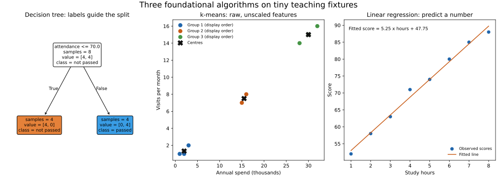

# Lesson 1: Learning Paradigms and Core Algorithms

[Theory index](../README.md) · [Module overview](./README.md)

**Course:** Data Science and Analytics  
**Module IX:** Review of Machine Learning Basics  
**Estimated study time:** 55 minutes

## Learning objectives

- Explain the distinction between explicit rules and learned models.
- Identify a supervised target and distinguish classification from regression.
- Explain what unsupervised clustering attempts to discover.
- Describe linear regression, decision trees, and k-means.
- Choose a simple starting model and state its limits.

## 1. What machine learning changes

Traditional programming specifies operations and rules directly. In machine learning, an optimisation or learning procedure uses examples to fit a model, whose predictions depend on what was learned from those examples.

| Approach | Spam example |
| --- | --- |
| Explicit rules | A developer maintains keyword, sender, or message-pattern conditions |
| Supervised learning | A model is trained using email features and known spam/non-spam labels |
| Combined system | A learned score is used alongside explicit operational rules |

ML still requires programming: people choose data, targets, features, algorithms, objectives, and evaluation. It does not automatically discover the right question or correct biased examples.

A fitted spam model does not keep learning merely because new messages arrive. Updating it requires a defined retraining or online-learning process and suitable new data.

Use deterministic rules when an exact formula or stable policy already answers the question. Use learning when examples can support a useful predictive pattern that is difficult to specify manually.

## 2. Supervised and unsupervised tasks

The key question in this introductory comparison is: **what is the goal, and are known target answers used for training?**

| Paradigm | Training information | Goal | Example |
| --- | --- | --- | --- |
| Supervised classification | Features X and categorical target y | Predict a class or class probability | Spam versus non-spam |
| Supervised regression | Features X and numeric target y | Predict a numeric quantity | Sale price |
| Unsupervised learning | Features without training target answers for the task | Describe structure under a chosen objective | Customer clusters |

A category encoded as 0 or 1 is still a classification target; numeric storage does not turn it into regression.

A dataset can contain labelled fields while a particular clustering task remains unsupervised. Conversely, merely having no useful labels does not prove that clusters are the answer to the business question.

Anomaly detection can be supervised, unsupervised, or based on examples of normal behaviour, depending on the available information and objective. The lesson's unusual-login example specifically supplies no bad-event labels and is framed as an unsupervised investigation.

These are foundational categories, not an exhaustive taxonomy of all machine-learning settings.

## 3. Three foundational algorithms

### Linear regression

Linear regression learns coefficients for a numeric prediction. With one feature:

```text
predicted y = intercept + slope × x
```

Ordinary least squares chooses coefficients to minimise squared prediction residuals on the fitting data. With several predictors, the prediction is a weighted sum plus an intercept.

A coefficient describes an association under the fitted model. It does not establish causation, guarantee an exact future value, or necessarily respect natural output bounds. Module 8's regression example illustrates these limits.

### Decision trees

A supervised tree learns splits using labelled examples. A node might ask whether attendance is at most a threshold, then send the record down one branch.

- A classification tree uses targets to choose splits that reduce class mixing.
- A regression tree chooses splits to reduce numeric prediction error, commonly predicting a leaf average.
- Depth or leaf-size constraints limit how complicated the tree becomes.

A tree does not have to produce perfectly pure leaves. A deep tree can memorise noise and become difficult to read. Small readable trees are easier to inspect, but interpretability alone does not establish accuracy, stability, fairness, or a causal explanation.

The [scikit-learn tree guide](https://scikit-learn.org/stable/modules/tree.html) covers both classification and regression trees.

### k-means

k-means takes numeric feature vectors and a chosen number k. It seeks clusters with a small sum of squared Euclidean distances to their assigned centres.

Conceptually:

1. Initialise k centres.
2. Assign each point to its nearest centre.
3. Replace each centre with the mean of its assigned points.
4. Repeat until a stopping condition is reached.

Initialisation affects the result, so implementations often use careful initialisation and multiple runs. The fitted solution need not be the global optimum.

Cluster IDs are arbitrary. Cluster 0 is not inherently low-risk, valuable, or first in an ordered scale. Interpret groups using the features, context, stability, and purpose.

Feature units matter because k-means uses distances. Scaling or transformations may be appropriate; choose them deliberately. Unequal-density, non-spherical, or highly skewed groups may not fit its objective well. See the [k-means documentation](https://scikit-learn.org/stable/modules/clustering.html#k-means).

## 4. Start simple, then evaluate

A simple model is useful because it can be easier to explain, debug, reproduce, and operate. It also establishes a baseline for evaluating added complexity.

That does not mean a simple model always predicts best or is automatically trustworthy. Compare candidates using suitable validation, relevant metrics, and the actual operational constraints.

For a binary churn target, use a classifier such as a small decision tree or logistic regression. Ordinary linear regression is not interchangeable with logistic regression simply because both names contain “regression.”

Data quality remains central:

- Incorrect or inconsistent labels teach the wrong task.
- Missingness and format errors can distort features.
- Biased examples can fail to represent future users.
- Leakage can make validation look better than real use.
- Features unavailable at prediction time cannot support a deployable prediction.

## 5. Worked practice

### Practice 1 — Rules or learning?

| Task | Starting approach | Reason |
| --- | --- | --- |
| Celsius to Fahrenheit | Rules | A known conversion formula is sufficient |
| Recognise a cat in a photograph | ML candidate | Image patterns are difficult to capture in a small explicit rule set |
| Shopping-cart total under defined tax rules | Rules | Deterministic arithmetic and policy |
| Predict next month's cancellations | ML candidate | Learn from suitable historical outcomes |
| Flag likely transaction fraud | ML or a hybrid system | Labels and patterns may help, while explicit controls can also matter |

ML is not automatically required for every fuzzy problem: it needs suitable examples, measurable objectives, and evidence of benefit.

### Practice 2 — Classify the learning task

1. **Tomorrow's temperature:** supervised regression if historical weather/outcome pairs are used.
2. **Unlabelled article topics:** unsupervised clustering; text must first have a suitable numeric representation.
3. **Spam versus non-spam:** supervised classification with labelled examples.
4. **Unusual logins without bad-event examples:** an unsupervised anomaly-detection task as framed here.
5. **House price:** supervised regression if historical sale prices supply the target.

The distinction is the training target and goal, not whether the output happens to be encoded numerically.

### Practice 3 — Read the learned tree

The exercise supplies eight rows with [hours studied, attendance percent] and a passed/not-passed target:

```python
from sklearn.tree import DecisionTreeClassifier, export_text

X = [[1,50],[2,60],[8,90],[7,85],[1,40],[9,95],[3,55],[6,80]]
y = [0,0,1,1,0,1,0,1]

tree = DecisionTreeClassifier(max_depth=2, random_state=0).fit(X, y)
print(export_text(tree, feature_names=["hours", "attendance"]))
print("prediction:", tree.predict([[5,75]])[0])
```

A fixed random_state makes the teaching run reproducible. More than one split can separate this tiny fixture perfectly; the source leaves tie-breaking unfixed.

Read the exported threshold and branches as rules learned from these labels. The script predicts pass for [5,75] in the tested configuration.

A readable branch helps explain the model's output and identify suspect features. It does not prove that increasing attendance causes passing or that the tree generalises to new students.

No held-out performance estimate is claimed for this eight-row demonstration.

### Practice 4 — Group unlabelled customers

Features are annual spend in thousands and visits per month:

```text
[2,1], [3,2], [1,1],
[30,15], [28,14], [32,16],
[15,7], [16,8]
```

Run k-means with k=3, n_init=10, and random_state=0, without providing a target y.

The resulting groups have centres, sorted here only for readability:

| Centre order | Annual spend (thousands) | Visits per month | Records |
| --- | ---: | ---: | ---: |
| Lower spend | 2.0 | 1.333... | 3 |
| Middle spend | 15.5 | 7.5 | 2 |
| Higher spend | 30.0 | 15.0 | 3 |

The rows above describe this fixture, not meaningful customer types discovered in an actual marketing study. Numeric cluster IDs can be permuted without changing the grouping.

The reproduction uses the raw features exactly as the exercise does. Their units affect the distance calculation; test an appropriate scaling strategy on real data rather than treating this choice as universal.

Unlike the tree, clustering uses no passed/churn labels to guide these assignments. An analyst must still judge whether its groups are stable and useful.

### Practice 5 — Telecom brief

**Predict churn:** supervised binary classification using historical, well-defined next-month churn labels. Start with a small decision-tree classifier as one baseline; compare it with a trivial baseline and other suitable classifiers.

**Discover segments:** unsupervised clustering, with k-means as a candidate for suitable numeric customer features. Choose k, scaling, and validation according to the objective rather than assuming three clusters are always appropriate.

Starting simply supports inspection, debugging, reproducibility, and a clear benchmark. Add complexity when validation and operating needs justify it.

Both projects can fail through duplicate records, biased coverage, invalid features, or inconsistent missing-data handling. Future-only information leaking into training can especially undermine churn evaluation.

## 6. Runnable algorithm examples

[lesson01-learning-demo.py](./lesson01-learning-demo.py) fits the source tree and k-means fixtures and carries forward Module 8's study-hours example as a LinearRegression demonstration.



All three panels use tiny teaching fixtures. The tree and regression use supplied targets; the k-means fit uses only the customer features. The displayed group order is chosen for readability and is separate from the raw cluster IDs.

From this directory:

```powershell
python lesson01-learning-demo.py
python lesson01-learning-demo.py --plot
```

Install the versions recorded in [lesson01-requirements.txt](./lesson01-requirements.txt). Numerical examples need NumPy and scikit-learn; plotting additionally needs Matplotlib.

The script prints the exact learned tree rules, its example prediction, raw cluster IDs, sorted centres, and regression coefficients. The plotting option writes the committed SVG and a PNG preview.

These fits illustrate mechanics. They do not include a train/test evaluation, deployment, online updates, or evidence of performance on real students or customers.

## 7. Theory exercises — suggested answers

Use these as study references and explain the ideas in your own words for course submissions.

### Task 1 — ML versus traditional programming

In traditional programming, a developer specifies the rules directly. For spam detection, those might be keyword and sender conditions that must be maintained manually.

In supervised machine learning, the developer provides examples of spam and non-spam with suitable features, and a training algorithm fits patterns that help classify new messages. The model still depends on the quality and relevance of those examples, and it needs an explicit updating process as conditions change.

### Task 2 — Supervised versus unsupervised

The main distinction is whether known target answers are used to train the task. Supervised learning learns a relationship between inputs and labelled outcomes so it can predict outcomes for new cases.

Unsupervised learning uses the input features without target answers to identify structure, such as clusters. The analyst still chooses the representation and objective and interprets the results.

### Task 3 — Decision tree versus k-means

A supervised decision tree uses labelled examples to learn feature tests that split records into groups useful for predicting the target. A new record follows those branches to a leaf prediction.

k-means does not use target labels. It assigns points to the nearest of k centres, moves the centres to their assigned points' means, and repeats toward a stable distance-based grouping.

The tree needs labels to learn which splits help predict the known outcome; k-means optimises a geometric grouping objective instead.

### Task 4 — Used-car values and visitor types

1. **Used-car value:** supervised regression, using historical mileage/year features and observed sale values. Linear regression is a foundational starting model from the lesson because the target is numeric. It produces an estimate, not a guaranteed exact market value.
2. **Anonymous visitor types:** unsupervised clustering, with k-means as a candidate after browsing behaviour is encoded into suitable numeric features and scaled appropriately. The groups are learned without predefined type labels and still need interpretation.

Model suitability should be checked rather than assumed from the name of the task.

### Task 5 — Simple models and engineering

Simple interpretable models provide a baseline that is easier to inspect, explain, debug, reproduce, and maintain. They can reveal label or feature problems before a more complicated system makes those problems harder to diagnose.

More complexity should be justified by validated gains and the application's needs. Simplicity helps engineering, but it does not replace evaluation or guarantee that a model is accurate or unbiased.

## 8. Quick revision

- Use exact rules when an exact rule already answers the task.
- ML learns fitted parameters or decision rules from examples.
- Supervised targets can be categorical or numeric.
- Unsupervised groups are not automatically meaningful classes.
- Decision trees support both classification and regression.
- k-means depends on k, feature representation, scale, and initialisation.
- A fitted model does not update itself automatically.
- Start with a baseline and evaluate generalisation.
- Interpretable does not mean proven correct, fair, or causal.

## Sources

- User-supplied course material: *Module IX: Review of Machine Learning Basics, Learning Paradigms and Core Algorithms*.
- [scikit-learn: Linear models](https://scikit-learn.org/stable/modules/linear_model.html#ordinary-least-squares).
- [scikit-learn: Decision trees](https://scikit-learn.org/stable/modules/tree.html).
- [scikit-learn: k-means](https://scikit-learn.org/stable/modules/clustering.html#k-means).

Worked responses, clarifying notes, fitted teaching examples, and the illustration were prepared for this repository.

[Module overview](./README.md) · [Theory index](../README.md)
