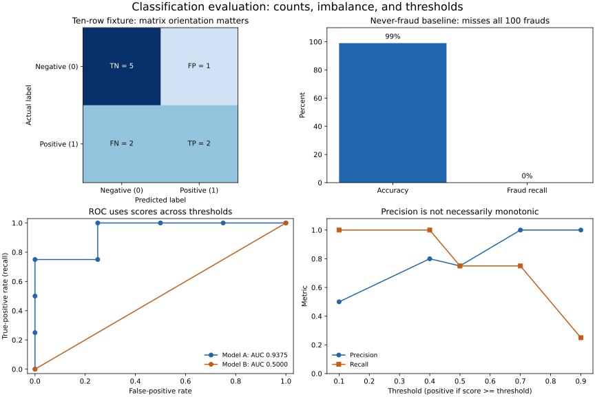

# Lesson 2: Evaluating Models Beyond Accuracy

[Theory index](../README.md) · [Module overview](./README.md) · [Previous lesson](./Lesson-01-Learning-Paradigms-and-Core-Algorithms.md)

**Course:** Data Science and Analytics  
**Module IX:** Review of Machine Learning Basics  
**Estimated study time:** 55 minutes

## Learning objectives

- Interpret binary confusion counts and matrix orientation.
- Explain the majority-class accuracy trap.
- Compute precision, recall, F1, and false-positive rate.
- Compare thresholds in light of error costs.
- Interpret ROC curves and AUC without confusing ranking with calibration or deployment performance.

## 1. Start with the positive class and four counts

Define which outcome counts as **positive** before calculating metrics. In a fraud example, positive means fraud; in a spam example, it means spam.

| Actual / predicted | Predicted positive | Predicted negative |
| --- | --- | --- |
| Actual positive | TP: correctly flagged | FN: missed positive |
| Actual negative | FP: false alarm | TN: correctly cleared |

The source uses positives first. scikit-learn's binary confusion_matrix with labels=[0,1] uses actual labels as rows and predicted labels as columns:

```text
             Predicted 0   Predicted 1
Actual 0          TN            FP
Actual 1          FN            TP
```

Both layouts are valid when labels are clear. Do not read a matrix without checking its orientation.

Many single-threshold classification metrics can be derived from these counts. A ROC curve additionally requires scores or decisions across thresholds; one fixed confusion matrix is not enough to recover it.

## 2. Error costs depend on the task

False negatives miss actual positives. False positives trigger action on actual negatives. Their consequences depend on the action, setting, and affected people.

In a screening illustration, missing a real case may justify strong emphasis on recall. False alarms can still have serious downstream costs; they are not merely harmless stress. In a spam filter, incorrectly hiding an important legitimate email can motivate emphasis on precision.

Fraud-alert systems may need a different operating point when every alert triggers an expensive investigation. A recommendation widget may care about precision among the displayed suggestions, while relevance coverage and user outcomes can also matter.

These are illustrative evaluation priorities, not universal deployment rules. Choose constraints with domain stakeholders and evaluate both types of error.

## 3. Accuracy can hide complete failure on the target class

```text
Accuracy = (TP + TN) / (TP + TN + FP + FN)
```

Suppose 100 of 10,000 transactions are fraud. A never-fraud predictor has:

| TP | FN | FP | TN |
| ---: | ---: | ---: | ---: |
| 0 | 100 | 0 | 9,900 |

Its accuracy is 99%, but fraud recall is 0%. It fails the purpose of catching fraud while matching the majority class.

Accuracy is not mathematically false; the problem is treating it as a sufficient summary. Report the class prevalence, baseline, confusion counts, and relevant class-specific metrics.

## 4. Precision, recall, F1, and false-positive rate

| Metric | Formula | Main question |
| --- | --- | --- |
| Precision | TP/(TP+FP) | Among flags, what fraction are actual positives? |
| Recall / true-positive rate | TP/(TP+FN) | Among actual positives, what fraction were flagged? |
| F1 | 2PR/(P+R), equivalently 2TP/(2TP+FP+FN) where defined | How does this operating point combine precision and recall? |
| False-positive rate | FP/(FP+TN) | Among actual negatives, what fraction were flagged? |

F1 is a harmonic mean that becomes low when either precision or recall is low. It does not include TN, encode all business costs, or identify a universally best model.

### Undefined denominators

- If nothing is predicted positive, precision is undefined.
- If no actual positives exist, recall is undefined.
- Software may replace undefined scores with zero or another configured value; report that convention.

For the never-fraud example, precision is undefined, recall is zero, and F1 is zero because the data contain missed positives. A displayed precision of zero would be a chosen reporting convention, not the result of dividing 0 by 0.

The [precision documentation](https://scikit-learn.org/stable/modules/generated/sklearn.metrics.precision_score.html) explains zero-division options.

## 5. Thresholds change the operating point

With a fixed scoring model, lowering the threshold flags a larger or equal set of records. TP and FP cannot decrease, and recall and false-positive rate cannot decrease when their denominators are nonzero.

Precision does **not** have to change monotonically. Adding a positive can improve it; adding a negative can reduce it. A higher score is not proof that a case is certainly positive.

### Flag everything

If actual positives exist:

```text
TP = all actual positives
FN = 0
FP = all actual negatives
TN = 0
Recall = 1
Precision = positive prevalence
```

Every actual negative becomes a false alarm. On the 1%-fraud dataset, precision is 1% and recall is 100%.

Choose thresholds using an appropriate validation procedure, workload, and cost constraints. Repeatedly choosing the best threshold on the final test set leaks evaluation information into model selection.

## 6. ROC and AUC

A ROC curve plots:

```text
horizontal axis: false-positive rate = FP/(FP+TN)
vertical axis: true-positive rate = recall = TP/(TP+FN)
```

It summarises different decision thresholds for fixed scores. AUC measures area under that curve.

For a binary ranking, ROC AUC can be interpreted as the probability that a randomly selected positive receives a higher score than a randomly selected negative, with tied scores receiving half credit.

| AUC | Interpretation |
| --- | --- |
| 1.0 | Perfect positive–negative ranking on the evaluated data |
| 0.5 | Chance-level pairwise ranking; constant tied scores also give 0.5 |
| Below 0.5 | Worse-than-chance orientation on these labels/scores |

“Threshold-independent” means ROC AUC is not tied to one chosen cutoff. It does not mean independent of the evaluated population, scoring direction, sampling uncertainty, or dataset changes.

An AUC of 1 does not guarantee perfect calibration, a suitable operational threshold, or performance on future data. An AUC near 0.5 does not prove that no useful pattern could be learned from the underlying features.

On severe imbalance, a modest false-positive rate can still produce a large number of alerts. Inspect precision–recall curves or average precision as well as ROC, absolute counts, and the decision context. The [scikit-learn evaluation guide](https://scikit-learn.org/stable/modules/model_evaluation.html#classification-metrics) covers these complementary views.

## 7. Worked practice

### Practice 1 — Read the supplied matrix

The hypothetical classifier has TP=45, FN=5, FP=100, TN=850.

- Five actual positive cases were missed.
- One hundred actual negatives were incorrectly flagged.
- There are 50 actual positives and 950 actual negatives.
- Screening and spam-filter use cases can place different consequences on the same counts.

For screening, investigate the consequences of missed cases alongside downstream false-alarm burdens. For spam, pay attention to legitimate messages incorrectly sent to the spam folder.

No single score fully states these counts, costs, and decisions.

### Practice 2 — Expose the majority baseline

The never-fraud predictor catches 0 of 100 frauds. Its 9,900 correct negatives generate 99% accuracy, masking its zero fraud recall.

Compare any proposed detector with this baseline, but do not stop there: alerts need a useful workload, precision, and detection rate for the intended setting.

### Practice 3 — Compute the ten-record metrics

```text
Actual:    [1,1,1,1,0,0,0,0,0,0]
Predicted: [1,1,0,0,1,0,0,0,0,0]

Matrix, actual rows / predicted columns in order [0,1]:
[[5,1],
 [2,2]]

TN=5, FP=1, FN=2, TP=2
```

```text
Precision = 2/(2+1) = 2/3 ≈ 0.666667
Recall = 2/(2+2) = 1/2 = 0.5
F1 = 2×2/(2×2+1+2) = 4/7 ≈ 0.571429
Accuracy = (2+5)/10 = 0.7
```

Two of three flagged records are correct, and two of four actual positives are detected. F1 provides one combined score but should remain alongside the counts and decision-relevant metrics.

### Practice 4 — Prioritise according to consequences

| Scenario | Course emphasis | Qualification |
| --- | --- | --- |
| Cancer-screening illustration | Recall | Missed cases can be consequential; false alarms and further procedures still matter |
| Spam filtering | Precision | Incorrectly hiding real messages may be costly |
| Expensive fraud investigations | Precision | Investigation capacity and false-alarm cost matter, alongside missed fraud |
| Threat-detection illustration | Recall | Misses can be consequential; operational capacity still constrains the system |
| “You may also like” widget | Precision among displayed suggestions | Relevance coverage and actual user outcomes also matter |

There is no single universally best metric or threshold. A metric priority is a decision objective to validate, not permission to ignore the other errors.

### Practice 5 — Compare AUC and threshold behaviour

The eight-row scoring example has four positives and four negatives.

| Model | Scores | ROC AUC |
| --- | --- | ---: |
| A | Varying scores with one positive–negative ranking inversion | 0.9375 |
| B | Every score is 0.5 | 0.5 |

Model A ranks 15 of the 16 positive–negative pairs correctly. Model B ties every pair, earning half credit.

Model A has better overall ranking on this fixture. An operational choice still needs a threshold, validation, and cost analysis.

For Model A, predict positive when score≥threshold:

| Threshold | TP | FP | FN | TN | Precision | Recall |
| ---: | ---: | ---: | ---: | ---: | ---: | ---: |
| 0.9 | 1 | 0 | 3 | 4 | 1.00 | 0.25 |
| 0.7 | 3 | 0 | 1 | 4 | 1.00 | 0.75 |
| 0.5 | 3 | 1 | 1 | 3 | 0.75 | 0.75 |
| 0.4 | 4 | 1 | 0 | 3 | 0.80 | 1.00 |
| 0.1 | 4 | 4 | 0 | 0 | 0.50 | 1.00 |

Lowering the threshold from 0.5 to 0.4 increases both recall and precision in this sample. This demonstrates why the usual trade-off is not a mathematical guarantee of monotonic precision at every step.



The first two panels use different source fixtures. The ROC and threshold panels share the balanced eight-row score example; do not confuse its 50% prevalence with the 1%-fraud baseline.

## 8. Reproduce the calculations and plots

[lesson02-evaluation-demo.py](./lesson02-evaluation-demo.py) computes the metrics directly and with scikit-learn, then plots the evaluation examples.

From this directory:

```powershell
python lesson02-evaluation-demo.py
python lesson02-evaluation-demo.py --plot
```

Use the dependencies recorded in [lesson01-requirements.txt](./lesson01-requirements.txt). The plotting option writes the SVG and a PNG preview.

The helper represents undefined count-based metrics as None. scikit-learn calls explicitly use zero_division=np.nan where appropriate. This avoids silently pretending an undefined denominator produced a measured zero.

These are fixed teaching labels and scores, not outputs of a trained clinical, financial, security, or production model. No claim of generalisation follows from the fixture metrics.

## 9. Theory exercises — suggested answers

Use these as study references and explain the reasoning in your own words for course submissions.

### Task 1 — Accuracy on imbalanced data

If 99% of transactions are legitimate, a model that always predicts legitimate achieves 99% accuracy without catching any fraud. It has TP=0 and FN equal to all actual frauds, so fraud recall is zero.

Accuracy is dominated by the majority class and conceals the model's failure at fraud detection. Inspect the confusion matrix, class prevalence, precision, and recall rather than accepting accuracy alone.

### Task 2 — Precision and recall

```text
Precision = TP/(TP+FP) = 80/(80+20) = 80/100 = 0.8 = 80%

Recall = TP/(TP+FN) = 80/(80+10) = 80/90 ≈ 0.8889 = 88.89%
```

Among flagged cases, 80% are actual positives. Among actual positives, about 88.89% are detected. TN is not needed for these two calculations.

### Task 3 — Error costs

In the cancer-screening illustration, false negatives are especially concerning because an actual case may be missed and further assessment delayed. This motivates attention to recall, while acknowledging that false positives can also have important consequences.

In a spam filter, a false positive is a legitimate email incorrectly classified as spam. Losing an important message can be more costly than receiving some unwanted mail, motivating attention to precision.

The final operating choice depends on the application and its error consequences rather than a universal rule.

### Task 4 — Flag everything

Flagging every record makes all actual positives true positives and leaves no false negatives, so recall is 100% when actual positives exist.

Every actual negative becomes a false positive. Precision becomes the fraction of the dataset that is actually positive, so it can be very low on an imbalanced dataset. High recall achieved this way does not imply a useful detector.

### Task 5 — ROC and AUC

A single precision or recall value describes one decision threshold. ROC shows the relationship between true-positive and false-positive rates across thresholds, and AUC summarises the score ranking without selecting one operating cutoff.

An AUC of 0.5 indicates chance-level positive–negative ranking on the evaluated data; a model assigning the same score to everyone also has AUC 0.5. Threshold-specific counts, precision, costs, and validation remain necessary for an operational decision.

## 10. Quick revision

- Define the positive class and matrix orientation.
- Distinguish false alarms from missed positives.
- Compare accuracy with the majority baseline.
- Keep precision and recall denominators explicit.
- Report undefined-metric conventions.
- F1 is useful but ignores true negatives and explicit costs.
- ROC uses false-positive rate, not false-positive count, on its horizontal axis.
- AUC measures ranking, not calibration or guaranteed future utility.
- Tune thresholds using validation rather than the final test set.
- Inspect absolute workload and rare-class performance.

## Sources

- User-supplied course material: *Data Science and Analytics, Module IX: Review of Machine Learning Basics, Evaluating Models Beyond Accuracy*.
- [scikit-learn: Classification metrics](https://scikit-learn.org/stable/modules/model_evaluation.html#classification-metrics).
- [scikit-learn: precision_score](https://scikit-learn.org/stable/modules/generated/sklearn.metrics.precision_score.html).
- [scikit-learn: roc_auc_score](https://scikit-learn.org/stable/modules/generated/sklearn.metrics.roc_auc_score.html).

Worked responses, clarifying notes, calculations, and evaluation figures were prepared for this repository.

[Previous lesson](./Lesson-01-Learning-Paradigms-and-Core-Algorithms.md) · [Module overview](./README.md) · [Theory index](../README.md)
