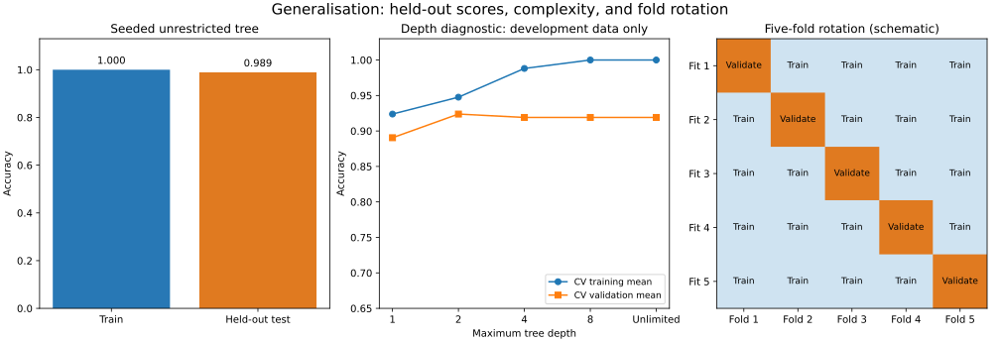

# Lesson 3: Overfitting, Underfitting and Cross-Validation

[Theory index](../README.md) · [Module overview](./README.md) · [Previous lesson](./Lesson-02-Evaluating-Models-Beyond-Accuracy.md)

**Course:** Data Science and Analytics  
**Module IX:** Review of Machine Learning Basics  
**Estimated study time:** 55 minutes

## Learning objectives

- Describe underfitting, overfitting, and their relationship to bias and variance.
- Distinguish training diagnostics, validation for selection, and final testing.
- Explain and run five-fold cross-validation.
- Detect preprocessing, outcome, group, and temporal leakage.
- Design an evaluation protocol for imbalanced classification.

## 1. Learn a pattern that transfers

A useful model must work on appropriate unseen observations, not merely reproduce its training answers.

**Underfitting** occurs when the model fails to capture important structure. In the lesson's usual example it is too simple, has high training error, and also performs poorly on new data. Poor features, inadequate optimisation, or excessive regularisation can produce similar symptoms.

**Overfitting** occurs when a fitted model adapts too closely to the particular training sample, including noise or accidental patterns. A very flexible model may have extremely low training error but substantially higher error on unseen observations.

| Pattern | Training error | Unseen-data error | Usual interpretation |
| --- | --- | --- | --- |
| Underfitting | High | High | Model has not captured enough useful structure |
| Suitable fit | Low | Comparably low | Evidence of transfer under the evaluation design |
| Overfitting | Very low | Substantially higher | Training-specific fit does not transfer sufficiently |

These are diagnostic patterns, not universal cutoffs. “Low” depends on the task, baseline, sample size, metric, and irreducible uncertainty. A small gap with poor scores is not a good fit. Perfect training accuracy alone does not prove overfitting: a simple, genuinely separable problem can permit it.

## 2. Bias and variance

Bias describes systematic error associated with the learning procedure's assumptions. A model restricted to an unsuitable simple pattern can have high bias.

Variance describes sensitivity to which training sample is observed. A highly flexible learner may produce noticeably different fitted rules from different samples, reflecting high variance.

The introductory association is:

- **Underfitting → high bias:** restrictions prevent learning important structure.
- **Overfitting → high variance:** sample-specific detail strongly influences the fitted model.

This is a useful guide, not a claim that model complexity alone determines performance. Data quantity, noise, features, regularisation, and training procedure also matter. Increasing complexity need not improve unseen-data performance.

## 3. Give each partition a clear role

| Data role | Used for | What it can tell us |
| --- | --- | --- |
| Training | Fit model parameters and learned preprocessing | How well the fitted model matches data it saw |
| Validation / CV validation folds | Compare models, hyperparameters, or thresholds | Evidence used for selection |
| Final held-out test | Evaluate the frozen procedure | An estimate on unseen data under the chosen sampling design |

Training scores are useful **diagnostics**. Compare them with validation scores to investigate fit. They are insufficient as independent estimates of generalisation because the same observations influenced the fitted model.

Keep the final test set out of feature selection, preprocessing fitting, hyperparameter selection, threshold tuning, and iterative development. If you repeatedly change the model after seeing its test results, that set has effectively become validation data.

A held-out score is still an estimate with sampling uncertainty. It does not guarantee performance after population or temporal changes. Splitting must reflect the intended prediction setting.

## 4. How k-fold cross-validation works

For ordinary non-overlapping k-fold CV on the development data:

1. Partition the observations into k approximately equal folds.
2. Hold out one fold as validation data.
3. Fit a fresh pipeline on the other k−1 folds.
4. Score the held-out fold without refitting on it.
5. Repeat until each fold has served as validation once.
6. Summarise the k scores, usually with their mean and a description of their spread.

Each row is used for validation once per ordinary k-fold run and training k−1 times. Each fit uses its own learned preprocessing. The final test partition is separate from these development folds.

For classification, stratified folds help preserve class proportions. In scikit-learn, cv=5 with a binary classifier uses unshuffled stratified folds by default. Explicitly specifying the splitter makes the intended design clearer.

Cross-validation reduces dependence on one arbitrary split and supports model comparison. It costs more computation and is not a guarantee of an unbiased estimate after extensive tuning. The standard deviation of fold scores describes their spread; it is not a confidence interval or standard error because the training sets overlap.

**Choose the split to match the data.** Keep repeated customers or patients in separate groups across partitions when evaluating new-group prediction. For future prediction, use an appropriate time-based design rather than randomly mixing past and future. Ordinary shuffled CV can be misleading in these settings.

## 5. Leakage: information unavailable at prediction time

Leakage lets evaluation information or future outcomes influence training. It can make evaluation scores look better than the procedure deserves.

| Workflow | Assessment | Correction |
| --- | --- | --- |
| Fit a scaler on all rows, then split | Evaluation statistics entered training | Split first; fit on training only |
| Fit a scaler on training, transform both partitions | Correct for this preprocessing step | Keep the same fitted scaler for new records |
| Use collections_agency_id, filled after default, to predict earlier default risk | Future/outcome information | Exclude it for that prediction time |
| Impute ages using combined train/test median | Evaluation data determined the replacement | Fit the imputer on training only |
| Put records from the same customer in both partitions for a new-customer task | Group overlap can give an optimistic estimate | Use group-aware partitions |

A pipeline helps fit imputation and scaling separately inside each CV training fold. Fitting preprocessing on the entire development set before CV still leaks information across its folds.

A pipeline cannot automatically recognise a future-only feature, duplicated entity, or unsuitable time split. Audit feature availability and the split design as well.

## 6. Worked practice

### Practice 1 — Diagnose the supplied scores

| Case | Training accuracy | Test accuracy | Gap | Intended diagnosis |
| --- | ---: | ---: | ---: | --- |
| 1 | 62% | 60% | 2 percentage points | Underfitting |
| 2 | 100% | 71% | 29 percentage points | Overfitting |
| 3 | 91% | 89% | 2 percentage points | Good fit |
| 4 | 55% | 54% | 1 percentage point | Underfitting |

Case 2 is the “memorised the answer key” illustration. Its perfect training score is accompanied by a large drop on unseen records, so training performance exaggerates its apparent usefulness.

These are the lesson's intended diagnoses assuming the accuracy levels are meaningful against a suitable baseline. Scores alone do not establish the cause: distribution shift, leakage, class imbalance, or noisy labels also deserve investigation.

### Practice 2 — Run the unrestricted tree honestly

The supplied dataset and split are retained. The source leaves the tree seed unset; the repository fixes random_state=0 for reproducibility.

```python
X, y = make_classification(n_samples=300, n_features=10, random_state=0)
Xtr, Xte, ytr, yte = train_test_split(
    X, y, test_size=0.3, random_state=0
)
tree = DecisionTreeClassifier(random_state=0).fit(Xtr, ytr)
```

With the recorded dependency versions:

| Quantity | Observed value |
| --- | ---: |
| Training rows | 210 |
| Held-out rows | 90 |
| Training accuracy | 1.000000 |
| Held-out accuracy | 0.988889 |
| Train-minus-test gap | 1.11 percentage points |

The result is **not** the lesson's separate illustrative 100% versus 71% example. On this synthetic split the unrestricted tree performs well on held-out records; the code does not demonstrate a large overfitting gap.

A flexible tree can overfit, but it is incorrect to claim that every unrestricted tree must do so. Here the training score alone would still be inadequate evidence; the independent held-out result supplies information the training score cannot.

### Practice 3 — Interpret five-fold cross-validation

The source example fits a depth-four tree to each training portion of a five-fold run on all 300 synthetic records:

```text
Fold accuracies: [0.933333, 0.950000, 0.950000, 0.966667, 0.983333]
Mean:            0.956667
Population std:  0.016997
```

The mean is about 95.67%, with fold-score standard deviation about 1.70 percentage points. Variation shows that performance depends somewhat on which records are held out. A large spread would motivate checking sample sizes, class counts, difficult subgroups, and the split design.

This reproduces the lesson as a standalone CV demonstration. Its full-dataset folds include rows used as held-out data in Practice 2, so these two exercises must not be combined into an untouched-test model-selection claim.

For a separate **development-only** complexity diagnostic, the script runs shuffled stratified CV on Practice 2's 210 training rows:

| Maximum depth | Mean CV training accuracy | Mean CV validation accuracy |
| --- | ---: | ---: |
| 1 | 0.923810 | 0.890476 |
| 2 | 0.947619 | 0.923810 |
| 4 | 0.988095 | 0.919048 |
| 8 | 1.000000 | 0.919048 |
| Unlimited | 1.000000 | 0.919048 |

Increasing flexibility improves training fit without improving validation performance beyond depth two in this run. The differences are small and dependent on the sample; they do not establish a universal best depth. No final-test result is used to choose a depth here.



### Practice 4 — Find and fix the four leaks

1. **Whole-dataset scaling leaks.** The test set influences learned means and standard deviations. Fit the scaler only on the training partition; transform validation/test data with those fitted parameters.
2. **Training-only scaling is correct for that step.** The test set is transformed without helping estimate the scaler. Other leakage risks still require checking.
3. **Post-default collections information leaks the future.** It would be unavailable when predicting an earlier default. Remove that feature or redefine the task and prediction time explicitly.
4. **Combined-data median imputation leaks.** Held-out ages influence the replacement. Estimate the median only from training data, including separately inside each CV fit.

A tiny executable example makes the information boundary visible: training values [20,40,missing] produce mean 30. Held-out values [100,missing] transform to [100,30]; the value 100 must not change the learned training mean.

Leakage is dangerous because ordinary scoring may not reveal the contaminated information path. An impressive result can therefore fail to transfer when the same information is unavailable for real predictions.

### Practice 5 — An honest churn-classifier protocol

1. **Define the task.** Specify the customer, prediction date, churn window, and what features are available at prediction time.
2. **Reserve a final test set before fitting learned transformations.** Choose temporal or group-aware splitting where needed; use stratification for an appropriate independent-row classification split.
3. **Build a development pipeline.** Fit imputation, encoding/scaling as needed, and the classifier within each training fold.
4. **Compare using suitable CV.** Select model settings and decision thresholds using development data only. Use nested CV if a separate estimate of a tuning procedure is needed.
5. **Report useful metrics.** For imbalanced churn, consider average precision or precision–recall curves for ranking, plus precision, recall, F1, and confusion counts at a justified operating threshold. Include prevalence and a baseline; accuracy alone can conceal missed churners.
6. **Audit leakage.** Prevent whole-dataset imputation/scaling and features recorded after churn. Check overlapping customers and future observations as well.
7. **Watch fit diagnostics.** A large training-minus-validation gap can indicate overfitting; uniformly poor scores can indicate underfitting or inadequate features.
8. **Freeze and evaluate.** Refit the chosen pipeline on development data, evaluate once on the reserved test set, and state the sampling limits. Returning to tuning requires treating that test set as part of development and obtaining fresh final evaluation.

The script includes a separate imbalanced **synthetic** example with median imputation, scaling, logistic regression, and stratified development CV. It does not select settings from its final test score.

The course's honesty theme is that a performance claim needs evidence from observations that did not influence the evaluated fitting and selection procedure.

## 7. Reproduce the examples

Run [lesson03-generalisation-demo.py](./lesson03-generalisation-demo.py) from this folder:

```powershell
python lesson03-generalisation-demo.py
python lesson03-generalisation-demo.py --plot
```

Use [lesson01-requirements.txt](./lesson01-requirements.txt) for the tested dependencies. The plotting option writes the SVG and a PNG preview.

The script fixes random seeds, uses fresh models per CV fit, and limits numerical-library threads for these small examples. Outputs describe synthetic teaching runs, not real customer outcomes or deployment performance.

## 8. Theory exercises — suggested answers

Use these as study references and explain the reasoning in your own words for course submissions.

### Task 1 — Defining overfitting and underfitting

Underfitting occurs when a model is too simple or restrictive to capture the important patterns in the data. It typically has high training error and also performs poorly on unseen data.

Overfitting occurs when a model is too complex relative to the available evidence and fits training-specific details, including noise. It typically has very low training error but higher error on unseen data. The goal is to learn useful patterns that transfer.

### Task 2 — The bias–variance trade-off

Underfitting is associated with high bias: the model's assumptions are too restrictive to represent the important pattern.

Overfitting is associated with high variance: the fitted model is overly sensitive to the particular training sample. Balancing flexibility and regularisation helps control these errors so the model can generalise.

### Task 3 — Evaluating generalisation

A training accuracy of 99% describes performance on data that helped fit the model. It cannot independently show whether the model learned transferable structure or fitted sample-specific details.

Reserve a representative test partition, use development data and validation/CV for selection, then evaluate the frozen pipeline on the untouched test set. Fit learned preprocessing only on training data. The resulting test score estimates unseen-data performance under that evaluation design; it is not a guarantee for every future population.

Training accuracy remains useful for diagnosing fit, even though it is insufficient as a measure of generalisation.

### Task 4 — Mechanics of k-fold cross-validation

Divide the development dataset into k approximately equal folds. Train a fresh model on k−1 folds and evaluate it on the remaining fold.

Repeat this process k times, changing the held-out fold each time, so each observation is used for validation once. Calculate the mean of the k validation scores as the summary estimate and report their spread. Fit preprocessing within each training fold and keep the final test set separate.

### Task 5 — Identifying and fixing data leakage

Computing an imputation mean from the entire dataset lets test-set values influence the data preparation used for training. The test set is therefore no longer independent of the fitted procedure.

Split first. Fit the imputer using only the training partition, then use that same fitted imputer to transform training and test data. During cross-validation, refit the imputer on each fold's training portion; placing it inside the model pipeline makes this boundary easier to preserve.

## 9. Quick revision

- High training and validation error suggests underfitting; a large gap can suggest overfitting.
- Perfect training accuracy is a reason to inspect validation, not automatic proof of failure.
- High bias usually accompanies underfitting; high variance often accompanies overfitting.
- Training scores diagnose fit; validation guides selection; final testing evaluates the frozen procedure.
- Ordinary k-fold validates each development row once per run.
- Fold-score standard deviation is not a confidence interval.
- Learn transformations within each CV training fold.
- Respect prediction time, repeated entities, and feature availability.
- Keep final test results out of iterative tuning.
- Evaluate imbalance with relevant class-specific metrics and counts.

## Sources

- User-supplied course material: *Data Science and Analytics, Module IX: Review of Machine Learning Basics, Overfitting, Underfitting and Cross-Validation*.
- [scikit-learn: Cross-validation](https://scikit-learn.org/stable/modules/cross_validation.html).
- [scikit-learn: Common pitfalls and recommended practices](https://scikit-learn.org/stable/common_pitfalls.html).

Worked responses, clarifications, executable examples, and figures were prepared for this repository.

[Previous lesson](./Lesson-02-Evaluating-Models-Beyond-Accuracy.md) · [Module overview](./README.md) · [Theory index](../README.md)
