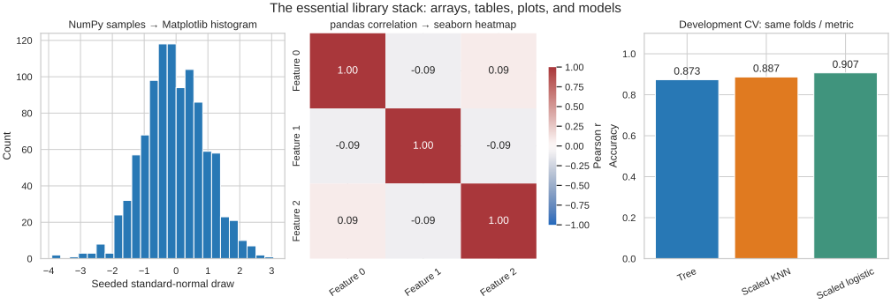

# Lesson 2: The Essential Library Stack

[Theory index](../README.md) · [Module overview](./README.md) · [Previous lesson](./Lesson-01-Python-as-the-Language-of-Data-Science.md)

**Course:** Data Science and Analytics  
**Module X:** Tools and Technologies for Data Science  
**Estimated study time:** 50 minutes

## Learning objectives

- Name the five libraries and distinguish their main roles.
- Explain NumPy's foundational role without assuming identical storage everywhere.
- Choose tools for tabular preparation, numerical work, plotting, and modelling.
- Use the common estimator interface while checking method-specific behaviour.
- Preserve fair evaluation when moving between tools.

## 1. A cooperating stack

The lesson groups five libraries by the work they make convenient:

| Layer | Library | Main role |
| --- | --- | --- |
| Numerical foundation | NumPy | Multidimensional arrays, numerical operations, and random sampling |
| Tabular data | pandas | Labelled Series and DataFrames; loading, cleaning, grouping, joining, reshaping |
| Plotting | Matplotlib | Figures, axes, artists, and detailed presentation control |
| Statistical visualisation | seaborn | Convenient statistical plotting built on Matplotlib |
| Machine learning | scikit-learn | Estimators, preprocessing, pipelines, splitting, and evaluation |

This is a conceptual map, not a strict sequence or a complete dependency graph. Projects revisit stages and may not need all five libraries. SciPy and other packages also contribute important infrastructure.

NumPy arrays act as a **common currency**: many numerical, plotting, and modelling interfaces accept them or array-like inputs. Compatible interfaces reduce the amount of custom adaptation needed between stages.

A shared foundation does not mean that every object has identical storage, every estimator accepts every dtype, or every transfer is free of copying.

## 2. NumPy: numerical arrays and operations

A NumPy ndarray represents a multidimensional array with a dtype. It supports operations such as elementwise arithmetic, matrix multiplication, aggregation, and random sampling.

Many operations use compiled implementations rather than Python-level loops. Performance depends on data size, dtype, memory layout, allocation, and the operation. The source's 100 ms versus 1 ms illustration is not a benchmark measured for this repository and is not a universal 100× guarantee.

```python
import numpy as np

a = np.array([[1, 2], [3, 4]])
b = np.array([[5, 6], [7, 8]])

print(a @ b)  # matrix multiplication
# [[19 22]
#  [43 50]]

rng = np.random.default_rng(0)
samples = rng.normal(size=1000)
```

The @ operator performs matrix multiplication here; a * b would multiply corresponding elements instead.

## 3. pandas: values with tabular meaning

pandas adds row/column labels, indexes, missing-value handling, and table operations. A column is a **Series**, not simply an ndarray.

For an ordinary integer column, .values returns an ndarray in the supplied example. However, nullable integer, categorical, string, and other extension dtypes can use different backing arrays.

Use .to_numpy() when an explicit NumPy representation is required, choosing dtype and missing-value handling deliberately. Conversion can copy data or change its representation. It also removes the Series index or DataFrame labels from the returned array. The [pandas conversion documentation](https://pandas.pydata.org/docs/reference/api/pandas.Series.to_numpy.html) describes these limitations.

Interoperability is therefore convenient, but correctness still requires preserving feature order, units, row alignment, and the meaning of missing values.

## 4. Matplotlib and seaborn cooperate

Matplotlib provides detailed control of figures and axes. It also has convenient high-level plotting functions; it is not restricted to low-level primitives.

seaborn adds statistical plotting interfaces and presentation defaults. Its axes-level functions can draw onto a Matplotlib Axes:

```python
fig, ax = plt.subplots(figsize=(6, 4))
sns.heatmap(df.corr(numeric_only=True), annot=True, ax=ax)
ax.set_title("Feature correlations")
ax.tick_params(axis="x", labelrotation=35)
```

Here seaborn constructs the heatmap, and Matplotlib adjusts the title and ticks. Some seaborn functions manage a whole figure rather than one Axes, so the return object and customisation pattern depend on the function.

A good-looking default is only a starting point. Choose a meaningful plot and inspect scales, labels, missingness, and statistical interpretation.

## 5. The scikit-learn interface

| Object / operation | Usual method | Meaning |
| --- | --- | --- |
| Estimator | fit | Learn parameters from training data |
| Predictor | predict | Produce predictions or assignments for supported inputs |
| Transformer | transform | Apply a fitted transformation |
| Combined fitting/transformation | fit_transform | Learn and transform training data |
| Model-specific default evaluation | score | Return the estimator's documented default score |

Many supervised classifiers share fit(X,y), predict(X), and score(X,y). This lets the same training and evaluation structure work with different algorithms.

The source's “every model has predict” statement is too broad. For example, StandardScaler uses transform rather than predict. Some unsupervised estimators fit without target labels. Default score meanings differ too: the classifiers in this lesson use accuracy, while a regressor commonly uses R².

The consistent interface helps comparison, but it does not make it fair automatically. Use the same suitable splits and metric, fit preprocessing within each training fold, and respect algorithm requirements such as feature scaling.

## 6. Worked practice

### Practice 1 — Map the layers

| Library | Role and relationship |
| --- | --- |
| NumPy | Numerical-array foundation used throughout this ecosystem |
| pandas | Labelled table operations; integrates with NumPy and also supports extension-backed data |
| Matplotlib | Plotting infrastructure that accepts arrays and other suitable data |
| seaborn | Statistical plotting interfaces built on Matplotlib |
| scikit-learn | Machine-learning tools that work with supported array-like, tabular, and sparse inputs |

The ndarray is the lesson's central shared numerical representation. Common interfaces let values flow through the stack with relatively little adaptation, although explicit conversion, encoding, copying, or validation may still be needed.

### Practice 2 — Inspect a pandas column

```python
df = pd.DataFrame({"score": [52, 63, 71, 88]})
col = df["score"]

print(type(col).__name__)                 # Series
print(type(col.values).__name__)          # ndarray
print(isinstance(col.values, np.ndarray)) # True
print(np.mean(col.values))                # 68.5
```

The mean is (52+63+71+88)/4 = 68.5. This numeric example demonstrates direct use of the column's values by NumPy; it does not prove that every pandas column has ndarray storage.

The companion script also constructs:

```python
nullable = pd.Series([52, None, 71], dtype="Int64")
print(type(nullable.array).__name__)  # IntegerArray
numeric = nullable.to_numpy(dtype=float, na_value=np.nan)
# [52., nan, 71.]
```

This makes conversion explicit and preserves missingness as NaN in the chosen floating-point representation.

### Practice 3 — Choose a library

| Task | Natural choice | Reason |
| --- | --- | --- |
| Read a 2 GB CSV and handle missing rows | pandas | Tabular I/O and missing-data operations |
| Multiply matrices and draw 1,000 normal samples | NumPy | Numerical arrays and random generation |
| Create a statistical correlation heatmap | seaborn | Convenient annotated heatmap interface |
| Train a tree and measure classification accuracy | scikit-learn | Classifiers and evaluation metrics |
| Fine-tune axis ticks and figure size | Matplotlib | Figure and axes control |
| Group sales by region and sum revenue | pandas | Label-aware groupby aggregation |

A 2 GB CSV can occupy much more than 2 GB in memory. Choose dtypes, needed columns, chunks, or another processing strategy according to resources. Dropping every row with any missing value is not automatically appropriate; assess missingness and its consequences first.

NumPy can implement table-related work, but named columns, mixed types, and group labels make pandas a more natural interface for these tasks.

In the script's small sales table, East totals 150 and West totals 80.

### Practice 4 — Swap classifiers using the same calls

The supplied dataset has 200 synthetic observations. Its default split produces 150 training and 50 test rows. The repository fixes the tree seed at zero for reproducibility; the shared fit/predict/score structure is retained.

| Classifier | Observed held-out accuracy |
| --- | ---: |
| DecisionTreeClassifier | 0.88 |
| KNeighborsClassifier | 0.86 |
| LogisticRegression | 0.94 |

These are source-style demonstrations on one split, using raw features. They show a common interface, not a reliable ranking of algorithms for all datasets.

The script separately compares a tree, scaled KNN, and scaled logistic regression using identical five-fold stratified CV on the 150 development rows:

| Pipeline | Mean CV accuracy | Population std of fold scores |
| --- | ---: | ---: |
| Tree | 0.873333 | 0.044222 |
| Scaled KNN | 0.886667 | 0.061824 |
| Scaled logistic regression | 0.906667 | 0.077172 |

Scaling is learned inside each training fold for KNN and logistic regression. The final test partition is excluded from these development folds. Fold-score standard deviations describe spread, not confidence intervals.

Because the source-style exercise already displays the test scores, these examples should not be used to claim a new untouched-test selection experiment. In a real project, reserve the test set until development and selection are finished.

The API consistency reduces code changes; fair comparison still comes from the evaluation design established in Module IX.

### Practice 5 — Trace a student pass/fail project

1. **pandas:** load the CSV, inspect schema and missingness, and investigate duplicate records. Decide which columns are valid predictors at the intended prediction time.
2. **NumPy / scikit-learn preprocessing:** represent numeric features as arrays as needed. For learned normalisation, fit a scaler inside the training pipeline rather than using whole-dataset statistics.
3. **Matplotlib and seaborn:** explore development data with a histogram and a correlation heatmap. Explain relationships without treating correlation as causation.
4. **scikit-learn:** choose appropriate development folds, fit a preprocessing/classifier pipeline, and evaluate with a justified metric. Reserve final testing for the frozen procedure.
5. **Interoperability:** compatible numerical and tabular interfaces connect these steps. Check labels, row alignment, feature order, missingness, and conversions at each boundary.

The workflow joins preparation, exploration, modelling, and honest evaluation in one cooperating toolset. It is not necessary to force every library into every stage.

## 7. Reproduce the examples

[lesson02-library-demo.py](./lesson02-library-demo.py) runs the array, table, and classifier examples. Its optional plot combines a NumPy-sample histogram, pandas correlation/seaborn heatmap, and development-CV summary.

```powershell
python -m pip install -r lesson02-requirements.txt
python lesson02-library-demo.py
python lesson02-library-demo.py --plot
```

[lesson02-requirements.txt](./lesson02-requirements.txt) records tested library versions. The --plot option writes the SVG and a PNG preview. No network downloads or external datasets are needed by the demo.



The histogram uses 1,000 seeded synthetic draws. The heatmap uses the first three development features, not outcomes or test data. The bar chart shows CV means, not final-test scores.

## 8. Theory exercises — suggested answers

Use these as study references and explain the reasoning in your own words for course submissions.

### Task 1 — Core library identification

- **NumPy:** numerical arrays, mathematical operations, and random sampling.
- **pandas:** labelled tables for loading, cleaning, grouping, and reshaping data.
- **Matplotlib:** plotting with control over figures, axes, and individual elements.
- **seaborn:** convenient statistical charts built on Matplotlib.
- **scikit-learn:** machine-learning models, preprocessing, and evaluation tools.

### Task 2 — The foundation of the stack

NumPy provides an efficient multidimensional array representation and numerical operations used widely across scientific Python.

Its arrays act as a common currency because many tools accept the same numerical representation or compatible array-like inputs. This reduces custom adaptation between preparation, plotting, and modelling. It does not guarantee that every transfer avoids conversion or copying, especially with non-NumPy-backed pandas dtypes.

### Task 3 — Library selection for a workflow

1. **pandas** for loading the CSV and cleaning columns, because it provides labelled tables and tabular preparation methods.
2. **NumPy** for matrix multiplication, because numerical-array operations are its core purpose.
3. **seaborn** for the statistical heatmap, because it offers a convenient interface with useful defaults.
4. **scikit-learn** for training the classifier, because it provides estimators and tools for appropriate splitting and evaluation.

### Task 4 — Visualisation tool comparison

Matplotlib provides detailed control of figures and axes. seaborn is built on Matplotlib and makes many statistical charts convenient to create.

For example, start with seaborn's heatmap to display a correlation matrix, then use the underlying Matplotlib Axes to change the title, tick rotation, labels, or layout. The tools cooperate: seaborn simplifies chart construction, while Matplotlib supports detailed customisation.

### Task 5 — Scikit-learn API analysis

scikit-learn gives many estimators a consistent interface. Supported classifiers can be fitted with fit and used for predictions with predict, so changing algorithms often requires only a small change to the construction step.

This reduces repeated code and supports shared pipelines and cross-validation workflows. Fair comparison still requires suitable preprocessing, the same evaluation splits, and an explicitly chosen metric. Methods vary by estimator type; transformers use transform, and score does not have one universal meaning.

## 9. Quick revision

- NumPy supplies arrays and numerical operations.
- pandas supplies labelled tabular operations.
- Matplotlib controls plots; seaborn simplifies statistical plotting.
- scikit-learn supplies estimators and evaluation infrastructure.
- Interoperability does not guarantee identical storage or zero copying.
- A pandas Series is richer than an ndarray.
- Check missingness, feature order, and row alignment.
- Use @ for matrix multiplication, * for elementwise multiplication.
- A common API helps comparison; it does not replace evaluation discipline.
- Fit learned preprocessing within training folds.

## Sources

- User-supplied course material: *Module X: Tools and Technologies for Data Science, The Essential Library Stack*.
- [pandas: Series.to_numpy](https://pandas.pydata.org/docs/reference/api/pandas.Series.to_numpy.html).
- [seaborn: Overview of plotting functions](https://seaborn.pydata.org/tutorial/function_overview.html).
- [scikit-learn: Estimator interfaces](https://scikit-learn.org/stable/developers/develop.html).

Worked responses, clarifications, numerical examples, and figures were prepared for this repository.

[Previous lesson](./Lesson-01-Python-as-the-Language-of-Data-Science.md) · [Next lesson](./Lesson-03-Cloud-Notebooks-Colab-Kaggle-and-Reproducibility.md) · [Module overview](./README.md) · [Theory index](../README.md)
