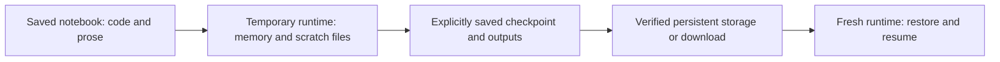

# Lesson 3: Cloud Notebooks — Colab, Kaggle and Reproducibility

[Theory index](../README.md) · [Module overview](./README.md) · [Previous lesson](./Lesson-02-The-Essential-Library-Stack.md)

**Course:** Data Science and Analytics  
**Module X:** Tools and Technologies for Data Science  
**Estimated study time:** 45 minutes

## Learning objectives

- Compare the strengths and limitations of Colab and Kaggle Notebooks.
- Distinguish a saved notebook from a temporary execution environment.
- Protect work with verified persistent outputs and resumable checkpoints.
- Record enough information to reproduce work outside the original runtime.
- Apply quota, privacy, and infrastructure discipline.

## 1. Browser-based access lowers the setup barrier

Cloud notebook platforms provide an interactive environment without requiring a full local scientific Python installation. Preinstalled libraries and access to remote compute can make coursework and prototyping easier on modest hardware.

| Platform | Specific strength | Specific limitation |
| --- | --- | --- |
| Google Colab | Convenient notebook sharing and Google Drive integration | Managed runtimes can be reclaimed; resource access and session duration are limited |
| Kaggle Notebooks | Hosted datasets, competition workflows, and a notebook community | Accelerator use is subject to quotas and session constraints |

Free accelerator access is an opportunity, not a guarantee of a particular GPU, uninterrupted availability, or unlimited use. Check the platform's current settings and your available quota before a long run.

The source's hardware prices and comparison with a well-funded laboratory are motivational illustrations, not a cost analysis reproduced here. Free notebooks do not provide the same guarantees or capacity as dedicated infrastructure.

Preinstalled packages also do not eliminate dependency conflicts. Additional installations can conflict with the base image, and platform images can change.

Platform details were checked against the official sources linked below on 7 November 2026. Exact quotas and interface labels can change, so this lesson does not depend on fixed GPU-hour figures.

## 2. Separate the document, runtime, and saved artifacts

A **notebook document** contains code, explanatory text, and optionally saved outputs. A **runtime** is the process or machine executing that code. A saved document does not automatically contain the model object, generated files, installed packages, or all memory state.

An **ephemeral runtime** is temporary. When it is reset, replaced, or reclaimed, assume its memory and unsaved local files can be lost. A browser disconnection is not necessarily a runtime reset: the remote process may continue for a time, but that is not a persistence plan.



For Colab, /content is ordinarily runtime-local scratch space. A completed write to an authorised persistent destination, such as mounted Drive, is different from a write to that scratch directory.

On Kaggle, save required artifacts through the documented notebook-output/version workflow or another approved destination. Session-persistence options may also exist; verify the configuration and retrieval behaviour. Merely writing a file during an interactive session is not sufficient evidence that it is durably saved.

Always confirm that a saved artifact can be found and read back independently of the current runtime. Notebook code survives only if the document or its latest changes were actually saved.

## 3. Save results, and checkpoint progress

An exported final model is useful for inference. A **training checkpoint** may need more state to resume work: model parameters, optimiser state, current epoch or step, learning-rate schedule, relevant random state, configuration, and references to the correct input data.

Checkpoint periodically to persistent storage during long jobs, rather than waiting until the session is about to end. Choose an interval that balances writing cost against acceptable lost work.

A checkpoint stored only on the same disposable disk is still disposable. Saving a notebook does not necessarily save its local checkpoint files. A completed download must exist on the receiving computer, not just have been requested.

The companion script demonstrates these boundaries locally using a deterministic task. It does not connect to Colab, Kaggle, Drive, or a GPU.

## 4. Reproduce the environment as well as the code

A notebook may work because its platform image already contains packages that the author never recorded. On another computer, missing packages can cause ModuleNotFoundError; incompatible versions can change APIs or results.

Record:

- Python and required package versions, plus an installation method.
- Input dataset identity, version or checksum, and permitted access instructions.
- Configuration, relevant seeds, and any required non-Python system dependencies.
- Hardware or accelerator details when they materially affect execution.
- Code version and instructions for a clean run.

From the Python environment that actually executes the work:

```powershell
python -m pip freeze > requirements-snapshot.txt
python -m pip list
python --version
```

In a notebook, ensure the command targets its kernel environment; an unrelated terminal's Python may differ. pip freeze produces installed-package entries in requirements format. pip list is useful for inspection but its default table is not a requirements file.

An environment snapshot can contain unrelated packages or local references. Review it and maintain a focused project dependency specification where appropriate. A snapshot is not a lockfile or proof of cross-platform compatibility.

Restart the kernel and run all cells in order, then test the recorded setup in a fresh environment when possible. Version pins alone do not prove reproducibility, and a successful clean run alone does not prove analytical correctness.

## 5. Quotas, privacy, and appropriate scope

Use an accelerator when the workload can benefit from it. Prepare data and debug small examples before consuming scarce accelerator time; stop unused sessions and monitor limits.

Use only data authorised for that cloud environment. Check dataset permissions, sharing settings, and whether saved outputs reveal private records or credentials. A personal account is not automatically an approved destination for organisational data.

Free interactive notebook runtimes are useful for learning, exploration, and prototypes. A production workflow needs an execution arrangement that meets its scheduling, storage, access control, monitoring, recovery, and availability requirements.

A notebook can be part of a controlled automated workflow. The issue is relying on a best-effort interactive free runtime as the production service, rather than the notebook file format itself.

## 6. Worked practice

### Practice 1 — Weigh the benefits and limitations

| Item | Classification | Qualification |
| --- | --- | --- |
| No local Python setup | Benefit | Additional project dependencies may still need configuration |
| Browser-based free GPU access | Benefit | Subject to availability, eligibility, and quotas |
| Reset can remove unsaved local state | Limitation | Persist important work separately |
| Remote compute from a modest laptop | Benefit | Not identical to dedicated laboratory infrastructure |
| GPU quotas / session limits | Limitation | Plan experiments around current allowances |
| Preinstalled packages hide dependencies | Limitation | Record and test the required environment |

The convenient preinstalled environment reduces setup effort while making it easy to overlook what must be recreated elsewhere.

### Practice 2 — What survives a reset?

| Item | Survival expectation | Protection |
| --- | --- | --- |
| Trained model held only in a variable | Does not survive loss of runtime memory | Export the model or checkpoint to persistent storage |
| CSV only in Colab /content | Assume lost when runtime storage is discarded | Copy to a verified persistent destination or download |
| File successfully saved to mounted Drive | Persists independently of the runtime | Confirm the write and read it back |
| Notebook code | Survives if the latest document was saved | Verify save/sync or export the notebook |
| Checkpoint successfully downloaded to the laptop | Persists on the laptop | Verify the file and its ability to load |

A 40-minute run should periodically save resumable state outside the runtime. Relying on the session to stay alive puts all progress since the last verified checkpoint at risk.

Closing the browser, stopping execution, and replacing the runtime are different events; the safe design does not depend on guessing when reclamation will occur.

### Practice 3 — Move work off-platform

1. The original cloud image had libraries or versions that the classmate's environment lacked.
2. Record the required packages, versions, Python version, input data, and setup instructions. Include system/accelerator requirements where relevant.
3. Use python -m pip freeze for a requirements-format snapshot. Use pip list to inspect installed versions.
4. Restart-and-run-all checks dependence on hidden cell history. A fresh setup test checks dependence on the original environment. Both are needed for a stronger reproducibility claim.

“Works on my Colab” describes one successful environment; reproducibility requires enough recorded information and verification for another suitable environment.

### Practice 4 — Apply quota and privacy discipline

| Action | Judgment | Reason |
| --- | --- | --- |
| Run a needless GPU job overnight | Risky | Wastes a limited resource and may exhaust the allowance |
| Upload a private customer database to personal Colab without authorisation | Risky | Uses an unapproved destination and can expose confidential information |
| Save model outputs to an authorised Drive destination | Appropriate | Protects work when the write is completed and verified |
| Use an available Kaggle GPU for a permitted coursework experiment | Appropriate | Matches the learning/prototyping use case |
| Depend on free Colab for a nightly production service | Risky | Session and resource limits do not supply production guarantees |

The unauthorised upload can violate confidentiality duties or applicable policies and obligations. Establish authorisation and use an approved environment before transferring such data.

### Practice 5 — A responsible cloud workflow

1. Use the preconfigured browser environment to begin quickly; check that the required resources are available.
2. Use authorised input data and record its identity and access method.
3. Record project dependencies, code version, configuration, and relevant seeds.
4. Save trained artifacts and generated outputs to an approved persistent destination. Checkpoint progress during long jobs.
5. Verify that saved artifacts can be retrieved and loaded.
6. Restart and run all cells in order; inspect results and test the setup outside the original runtime where practical.
7. Monitor quota and stop idle accelerator use.
8. Move operational workloads to infrastructure that satisfies scheduling, monitoring, recovery, security, and availability needs.

The course's recurring discipline is to collect responsibly, work reproducibly, evaluate honestly, and state the limits of a result.

## 7. Local checkpoint-and-resume demonstration

Run [lesson03-checkpoint-demo.py](./lesson03-checkpoint-demo.py):

```powershell
python lesson03-checkpoint-demo.py --output-dir lesson03-demo-output
```

It uses only the Python standard library and was tested with Python 3.12.14. The output folder is dedicated to the demo; rerunning replaces its named JSON outputs.

The task sums the squares of the integers 1 through 10:

```text
Checkpoint after step 4:  1² + 2² + 3² + 4² = 30
Final total at step 10:  385

scratch_existed_before_reset:  true
scratch_exists_after_reset:   false
checkpoint_exists_after_reset:true
saved_step:                   4
saved_total:                  30
resumed_total:                385
matches_uninterrupted:        true
```

A temporary directory represents runtime-local files. A checkpoint saved outside that directory remains available after the temporary directory is cleaned up. The script discards its in-memory state, reloads the saved JSON, resumes, and checks agreement with uninterrupted computation.

The output directory also receives a small environment/input manifest and a result summary. This is a controlled local simulation: the “persistent” directory is only outside the simulated runtime. It is not evidence that the current machine's disk, a cloud mount, or a network transfer is durable.

The file-replacement helper completes a sibling temporary file before replacing the local JSON destination. This is a local writing pattern, not a guarantee about cloud-storage transaction semantics or concurrent writers. Use one demo process per output directory.

## 8. Theory exercises — suggested answers

Use these as study references and explain the reasoning in your own words for course submissions.

### Task 1 — Cloud notebook platform comparison

Google Colab is convenient for sharing notebooks and working with Google Drive. A limitation is that managed runtimes can reset or be reclaimed, and available resources are limited.

Kaggle Notebooks integrates hosted datasets, competitions, and a learning community. A limitation is accelerator quotas and session constraints. Both reduce local setup effort, but neither provides unlimited guaranteed free GPU access.

### Task 2 — Managing ephemeral runtimes

An ephemeral runtime is a temporary execution environment. When it is reset or reclaimed, variables and files stored only on its disposable local disk can be lost.

Prevent loss by saving important outputs and resumable checkpoints to an approved persistent destination or by downloading them. Confirm the save and retrieval instead of assuming that saving the notebook also saved its generated files.

### Task 3 — The hidden dependency risk

A notebook may silently rely on libraries and versions already present in a cloud image. Another machine may lack those packages or use incompatible versions, so the same code can fail.

Record the required packages and versions, Python version, and setup instructions. A pip freeze snapshot can help identify installed packages, but review it and test the project in a fresh suitable environment. Record data and other execution requirements as well.

### Task 4 — Cloud notebook ethics and discipline

The first discipline is responsible quota and cost use: avoid unnecessary accelerator work, monitor available resources, and stop unused sessions.

The second is data privacy: do not transfer private or sensitive information to a third-party service without authorisation for that environment. These habits protect limited resources and prevent inappropriate disclosure of data.

### Task 5 — Appropriate tool scoping

A free interactive Kaggle runtime should not be relied on as the final infrastructure for a scheduled production service. Its quotas and temporary sessions do not provide the operational guarantees that such a service may require.

Move the successful prototype to infrastructure with appropriate scheduling, persistent storage, access control, monitoring, and recovery. Notebook files can still be used in a managed automated workflow; the key is the reliability and controls of the execution environment.

## 9. Quick revision

- Cloud notebooks reduce local setup, not every dependency problem.
- Free accelerator access is conditional and limited.
- Notebook documents, runtime memory, and output files are different.
- Browser disconnection does not necessarily equal runtime destruction.
- Confirm persistence and retrieval before relying on a saved artifact.
- Save resumable state during long jobs.
- pip freeze records installed packages; it does not prove reproducibility.
- Record inputs, versions, configuration, and relevant hardware.
- Restart and run all, then validate results.
- Respect quotas and data authorisation.
- Match production infrastructure to operational requirements.

## Sources

- User-supplied course material: *Module X: Tools and Technologies for Data Science, Cloud Notebooks: Colab, Kaggle and Reproducibility*.
- [Google Colab: Frequently asked questions](https://research.google.com/colaboratory/faq.html).
- [Kaggle: Notebooks documentation](https://www.kaggle.com/docs/notebooks).
- [Kaggle: Efficient GPU usage](https://www.kaggle.com/docs/efficient-gpu-usage).
- [pip: pip freeze](https://pip.pypa.io/en/stable/cli/pip_freeze/).

Worked responses, clarifications, and the local simulation were prepared for this repository.

[Previous lesson](./Lesson-02-The-Essential-Library-Stack.md) · [Module overview](./README.md) · [Theory index](../README.md)
